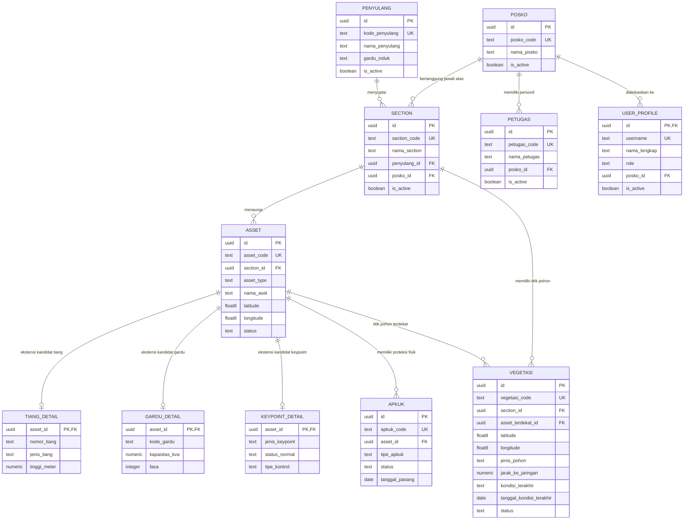
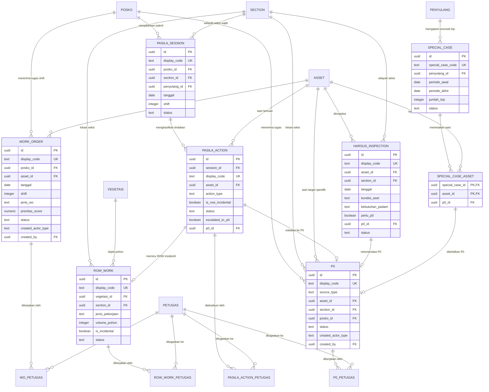
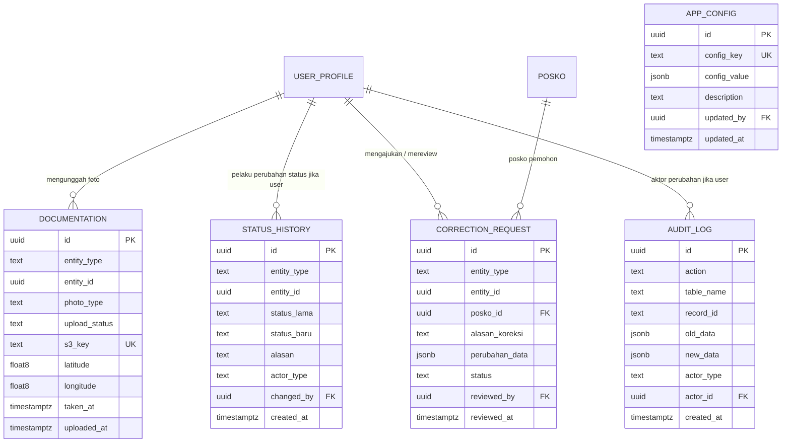

# DATA MODEL SPECIFICATION

## Sistem Pengelolaan Pekerjaan Preventive Jaringan Distribusi — ULP Sribhawono

**Status:** Draft / Final Draft (Subject to Open Questions Confirmation)  
**Source of Truth:** [PRD.md](file:///d:/PROJECT/ulp-sribhawono/docs/PRD.md) · [DESIGN_BRIEF.md](file:///d:/PROJECT/ulp-sribhawono/docs/DESIGN_BRIEF.md) · [TECHNICAL_SPEC.md](file:///d:/PROJECT/ulp-sribhawono/docs/TECHNICAL_SPEC.md)  
**Scope:** ULP Sribhawono (Single-Tenant)  
**Target RDBMS:** PostgreSQL (Supabase-managed)

---

# 1. Data Model Principles

Model data untuk Sistem Pengelolaan Pekerjaan Preventive Jaringan Distribusi ULP Sribhawono dirancang dengan prinsip-prinsip arsitektural berikut:

1. **Dual Identifier & UUID Strategy:**
   - **Client-Generated Offline Transactions (UUIDv7):** Seluruh record transaksi yang dapat dibuat oleh perangkat Android saat *offline* (`p0`, `work_order` offline response, `pasila_session`, `pasila_action`, `harsus_inspection`, `row_work`, `documentation`, serta junction rows `*_petugas`) menggunakan **UUIDv7**. UUIDv7 memiliki keunggulan berbasis waktu (*time-ordered / k-sortable*), ramah terhadap indeks B-tree database, dan dapat di-generate secara independen di client tanpa risiko tabrakan (*collision*) antar perangkat offline.
   - **Server-Generated & Master Records (UUID):** Entitas master dan entitas yang digenerate oleh server/background job (`posko`, `penyulang`, `section`, `asset`, `special_case`, `status_history`, `audit_log`, `app_config`) menggunakan UUID server-generated (UUIDv4 via `gen_random_uuid()` atau UUIDv7).
   - **PLN Business Key Preservation:** Seluruh kode/identitas resmi PLN eksisting (`posko_code`, `kode_penyulang`, `section_code`, `asset_code`, `id_gangguan`, `apkuk_code`, `vegetasi_code`) dipertahankan secara utuh sebagai kolom unik bertipe `TEXT UNIQUE`. Relasi internal menggunakan UUID, namun *business key* selalu dapat ditelusuri (*searchable*, *indexable*, dan *displayable*) pada UI dan laporan operasional.
   - **Secondary Human-Readable Display Codes:** Nomor urut yang mudah dibaca manusia (seperti `P0-YYYYMMDD-XXXX`) bukan kunci otoritatif untuk pembuatan data offline. Nilai ini bersifat sekunder (*display code*): dibuat server-side setelah sinkronisasi berhasil atau menggunakan format aman tabrakan (*collision-safe*) untuk menghindari kegagalan sinkronisasi antar perangkat.

2. **Relasi Wilayah Berjenjang (Hierarchical Boundary):**
   - Hierarki utama jaringan distribusi adalah:
     $$\text{PENYULANG} \leftarrow \text{SECTION} \rightarrow \text{POSKO}$$
     $$\text{ASSET} \rightarrow \text{SECTION}$$
   - Satu `section` terikat pada satu `penyulang` dan satu `posko` penanggung jawab wilayah.
   - `asset` berelasi langsung ke `section`. Relasi `asset` ke `posko` dan `penyulang` **tidak diduplikasi secara independen** pada tabel `asset`, melainkan diturunkan (*derived*) melalui relasi `section`. Hal ini mencegah anomali dependensi data jika batas seksi dipetakan ulang.

3. **Single-Tenant Scope (ULP Sribhawono):**
   - Sistem ini spesifik untuk ULP Sribhawono. Tidak ada penambahan kolom `ulp_id` ke seluruh tabel operasional internal. Informasi ULP hanya dicatat pada konfigurasi aplikasi (`app_config`) dan dipertahankan pada data mentah impor eksternal (`gangguan_raw`) sesuai struktur sumber aslinya.

4. **Pemisahan Tegas Master Data vs Transaksi Baru:**
   - **Master Data:** Merupakan data inventaris yang diimpor dari spreadsheet awal PLN (`posko`, `penyulang`, `section`, `asset`, `apkuk`, `vegetasi`, serta master `petugas` jika tersedia).
   - **Data Transaksi:** Seluruh pekerjaan operasional (`p0`, `work_order`, `pasila_session`, `pasila_action`, `harsus_inspection`, `row_work`) adalah data yang **baru dihasilkan oleh sistem**, bukan data historis yang diwajibkan untuk diimpor saat inisialisasi awal.
   - **Inspeksi Harsus:** Bukan data inventaris atau data historis awal; `harsus_inspection` adalah transaksi murni yang dibuat saat petugas Harsus melakukan kegiatan inspeksi lapangan.

5. **External Data Preservation (Zero-Loss Staging - 24 Kolom Sumber):**
   - Data gangguan pusat berasal dari spreadsheet/sumber eksternal PLN. Seluruh **24 kolom sumber** dipertahankan persis tanpa modifikasi pada tabel pementasan mentah `gangguan_raw`.
   - Untuk kebutuhan analitik aplikasi (WO prioritization, Special Case detection, riwayat aset), sistem menggunakan derivasi berupa *Materialized View* (`gangguan_mv`).

6. **Photo Storage Decoupling (Offline-Compatible Metadata Only):**
   - PostgreSQL tidak pernah menyimpan binary foto (*no BYTEA/BLOB*).
   - Record `documentation` dapat dibuat langsung saat offline dengan status `upload_status = 'PENDING'`. Kolom `s3_key` dan `uploaded_at` berstatus *nullable* sampai file foto berhasil diunggah ke Amazon S3 setelah perangkat terhubung kembali ke jaringan internet.
   - Path file lokal perangkat (`local_path`) hanya ada pada SQLite lokal Android dan tidak disimpan di skema PostgreSQL server.

7. **Struktur Akun vs Personel Lapangan (Junction Architecture):**
   - Satu akun login lapangan role POSKO mewakili satu Posko wilayah kerja (**1 Akun POSKO = 1 Posko**).
   - Model akun untuk tim HARSUS dan ROW tetap berstatus **OPEN QUESTION** (apakah 1 akun per tim atau akun per personil).
   - Petugas aktual yang melaksanakan pekerjaan di lapangan dipilih dari master data `petugas` melalui dropdown.
   - Seluruh relasi penugasan menggunakan **junction table** (`p0_petugas`, `wo_petugas`, `pasila_action_petugas`, `row_work_petugas`).

8. **Auditability & History (No Hard Delete selama Operasional Aktif):**
   - Seluruh transaksi pekerjaan operasional **tidak di-hard-delete selama operasional aktif**.
   - Perubahan status pekerjaan dicatat pada entitas riwayat audit `status_history`, yang mendukung pencatatan perubahan oleh pengguna (*user*) maupun otomatisasi sistem (*system job*).
   - Transaksi yang dapat dibuat oleh sistem (seperti P0 dari Special Case atau Work Order terjadwal) mendukung pencatatan `created_actor_type` (`USER`, `SYSTEM_JOB`, `EDGE_FUNCTION`) dengan `created_by` nullable jika di-generate oleh sistem.
   - Periode retensi dan pengarsipan jangka panjang (*retention/archive period*) berstatus **OPEN QUESTION**.
   - Metadata dan berkas foto dipertahankan sesuai *retention policy* yang disetujui stakeholder nantinya.
   - **S3 Versioning tetap enabled pada staging dan production** sebagai mekanisme perlindungan terhadap *accidental deletion/corruption*. Kebijakan lifecycle/archive/delete jangka panjang tetap berstatus **OPEN QUESTION**.
   - Koreksi data pasca-selesai dikelola melalui entitas formal `correction_request` yang membutuhkan persetujuan Admin.

9. **Zero Assumption on Unconfirmed Formulas & Vocabularies:**
   - Parameter prioritas WO, ambang batas *Special Case*, jadwal shift kerja, interval pemangkasan ROW, dan skoring kesehatan aset disimpan dalam tabel konfigurasi dinamis `app_config` atau ditandai sebagai **OPEN QUESTION**. Model data tidak memaksakan formula *hardcoded*.
   - Ambang batas *Special Case* (default trip > 3 per periode evaluasi) dikelola pada level konfigurasi / business logic, bukan hardcoded database CHECK constraint.
   - Jenis Work Order yang terkonfirmasi saat ini adalah `PEMASANGAN_APKUK`. Jenis preventif lain berstatus open question / extensible.
   - Peringkat/Ranking Posko **bukan fitur MVP** dan tidak dimodelkan sebagai tabel operasional inti.

---

# 2. Entity Categories

Entitas dalam model data dikelompokkan ke dalam 5 kategori:

```
┌────────────────────────────────────────────────────────────────────────┐
│                          ENTITY CATEGORIES                             │
├─────────────────┬──────────────────┬──────────────────┬────────────────┤
│ A. MASTER / REF │ B. EXTERNAL / RAW│ C. TRANSACTION   │ D. AUDIT / HIST│
├─────────────────┼──────────────────┼──────────────────┼────────────────┤
│ - posko         │ - gangguan_raw   │ - p0             │ - status_      │
│ - penyulang     │   (24 cols)      │ - p0_petugas     │   history      │
│ - section       │ - gangguan_mv    │ - work_order     │ - audit_log    │
│ - asset         │                  │ - wo_petugas     │ - asset_hist_  │
│ - tiang_detail  │                  │ - pasila_session │   view         │
│ - gardu_detail  │                  │ - pasila_action  │                │
│ - keypoint_det  │                  │ - pasila_action_ │                │
│ - apkuk         │                  │   petugas        │                │
│ - vegetasi      │                  │ - harsus_inspect │                │
│ - petugas       │                  │ - row_work       │                │
│ - user_profile  │                  │ - row_work_pet   │                │
│                 │                  │ - special_case   │                │
│                 │                  │ - sc_asset       │                │
│                 │                  │ - documentation  │                │
│                 │                  │ - correction_req │                │
├─────────────────┴──────────────────┴──────────────────┴────────────────┤
│ E. CONFIGURATION                                                       │
│ - app_config                                                           │
└────────────────────────────────────────────────────────────────────────┘
```

- **A. Master / Reference Data:** Data referensi aset kelistrikan, wilayah posko, seksi, penyulang, vegetasi, proteksi APKUK fisik, personil, dan profil otorisasi pengguna. Data diinisialisasi melalui migrasi awal dan dikelola Admin.
- **B. External / Imported Data:** Data gangguan bersumber dari sistem gangguan pusat PLN. Mempertahankan seluruh 24 kolom skema sumber secara utuh (`gangguan_raw`) dan diekspos melalui view analitik (`gangguan_mv`).
- **C. Operational Transaction Data:** Data kegiatan preventif harian yang dihasilkan oleh pengguna lapangan dan sistem (P0, WO, PASILA, Harsus, ROW, Special Case, Dokumentasi Foto, Permintaan Koreksi).
- **D. History / Audit Data:** Jejak kronologis mutasi status transaksi, log audit modifikasi data, dan view agregasi riwayat aset komprehensif.
- **E. Configuration Data:** Parameter sistem terpusat yang dapat diatur oleh Admin tanpa rilis ulang aplikasi (*dynamic business rules*).

---

# 3. Entity Inventory

| Entity | Category | Purpose | Primary Key Strategy | Source | Created By | Synced Offline? | Notes |
|---|---|---|---|---|---|---|---|
| `posko` | Master | Master wilayah posko pelayanan lapangan | Server UUIDv4 / UUIDv7 | Source: POSKO_ID, POSKO, STATUS | Admin / Migration | Ya (Read) | Kode & nama Posko eksisting |
| `penyulang` | Master | Master data penyulang distribusi (feeder) | Server UUIDv4 / UUIDv7 | Source Profiling | Admin / Migration | Ya (Read) | Gardu Induk & tegangan nominal |
| `section` | Master | Segmentasi jaringan dalam penyulang | Server UUIDv4 / UUIDv7 | Source Profiling | Admin / Migration | Ya (Read) | Hubungkan aset ke Posko & Feeder |
| `asset` | Master | Inventaris tiang, gardu, dan keypoint | Server UUIDv4 / UUIDv7 | Source Profiling | Admin / Migration | Ya (Read) | Koordinat nullable saat migrasi |
| `tiang_detail` | Master Subtype | Atribut teknis kandidat tipe Tiang | FK `asset.id` (1:1) | Pending Source Profiling | Admin / Migration | Ya (Read) | Candidate table (fields TBD) |
| `gardu_detail` | Master Subtype | Atribut teknis kandidat tipe Gardu | FK `asset.id` (1:1) | Pending Source Profiling | Admin / Migration | Ya (Read) | Candidate table (fields TBD) |
| `keypoint_detail` | Master Subtype | Atribut teknis kandidat Keypoint | FK `asset.id` (1:1) | Pending Source Profiling | Admin / Migration | Ya (Read) | Candidate table (fields TBD) |
| `apkuk` | Master | Inventaris alat pengaman APKUK yang ada | Server UUIDv4 / UUIDv7 | Source Profiling | Admin / Migration | Ya (Read) | Record mewakili fisik nyata |
| `vegetasi` | Master | Titik pohon berisiko Right of Way (ROW) | Server UUIDv4 / UUIDv7 | Source Profiling | Admin / Migration | Ya (Read) | Target pekerjaan & penjadwalan |
| `petugas` | Master | Personil lapangan anggota regu kerja | Server UUIDv4 / UUIDv7 | HR PLN / Admin | Admin | Ya (Read) | Dipilih via dropdown |
| `user_profile` | Master | Profil otorisasi & pemetaan peran | FK `auth.users.id` | Supabase Auth hook | Admin | Tidak (Online auth) | Role & referensi Posko |
| `gangguan_raw` | External | Staging data gangguan pusat PLN | Server UUIDv4 | External PLN (24 cols)| Admin / Adapter | Tidak (Server only) | 24 kolom sumber dipertahankan |
| `gangguan_mv` | External | Materialized view analitik gangguan | Mat View (uses raw id)| Derived (PostgreSQL) | PostgreSQL cron | Ya (Aggregates) | Percepatan analitik WO & SC |
| `p0` | Transaction | Penugasan Khusus prioritas tertinggi | Client UUIDv7 | New System | Admin/Harsus/System | Ya (Read/Write) | **Wajib titik aset spesifik** |
| `p0_petugas` | Transaction | Junction penugasan personil pada P0 | Composite FKs | New System | Posko / Admin | Ya (Read/Write) | Relasi N:N P0 ke Petugas |
| `work_order` | Transaction | Perintah kerja preventif (APKUK default) | Client/Server UUIDv7 | New System | Edge Func / Admin | Ya (Read/Write) | Default: PEMASANGAN_APKUK |
| `wo_petugas` | Transaction | Junction penugasan personil pada WO | Composite FKs | New System | Posko / Admin | Ya (Read/Write) | Relasi N:N WO ke Petugas |
| `pasila_session` | Transaction | Sesi Patroli Eksekusi Langsung per shift | Client UUIDv7 | New System | Posko | Ya (Read/Write) | **Wajib memiliki section_id** |
| `pasila_action` | Transaction | Temuan/tindakan langsung dalam patroli | Client UUIDv7 | New System | Posko | Ya (Read/Write) | Child record sesi PASILA |
| `pasila_action_petugas` | Transaction | Junction personil eksekutor PASILA | Composite FKs | New System | Posko | Ya (Read/Write) | Relasi N:N Action ke Petugas |
| `harsus_inspection` | Transaction | Hasil inspeksi intensif Tim Harsus | Client UUIDv7 | New System | Harsus | Ya (Read/Write) | Catat temuan & kebutuhan padam |
| `row_work` | Transaction | Pekerjaan perabasan / tebang pohon | Client UUIDv7 | New System | ROW / Posko | Ya (Read/Write) | Jenis: RABAS, PANGKAS, TEBANG |
| `row_work_petugas` | Transaction | Junction personil regu kerja ROW | Composite FKs | New System | ROW / Posko | Ya (Read/Write) | Relasi N:N ROW ke Petugas |
| `special_case` | Transaction | Insiden trip berulang (>3 trip/periode) | Server UUIDv4 / UUIDv7 | New System | System (Edge Func) | Ya (Read) | Threshold di app_config |
| `special_case_asset` | Transaction | Pemetaan aset terdampak Special Case | Composite FKs | New System | System (Edge Func) | Ya (Read) | Junction SC ke Aset |
| `documentation` | Transaction | Metadata foto bukti lapangan | Client UUIDv7 | New System | Mobile App | Ya (Read/Write) | S3 key nullable saat offline |
| `correction_request` | Transaction | Pengajuan koreksi pekerjaan SELESAI | Client/Server UUIDv7 | New System | Posko | Ya (Read/Write) | Workflow persetujuan Admin |
| `status_history` | History | Jejak audit pergantian status pekerjaan | Server UUIDv4 / UUIDv7 | New System | Trigger / System | Ya (Read) | Mendukung user & system actor |
| `audit_log` | History | Jejak perubahan data master & konfigurasi| Server UUIDv4 / UUIDv7 | New System | System Trigger | Tidak (Server only) | Mendukung user & system actor |
| `asset_history_view` | History | View agregasi riwayat aset komprehensif| Derived View | Database View | System Query | Ya (On-demand) | Riwayat gangguan & pekerjaan |
| `app_config` | Configuration | Parameter dinamis sistem & konfigurasi | Server UUIDv4 / UUIDv7 | Admin | Admin | Ya (Read) | Key-value JSONB |

---

# 4. Detailed Entity Definitions

---

## 4.1 Master / Reference Entities

### 4.1.1 `posko`
Menyimpan identitas unit posko pelayanan lapangan di bawah ULP Sribhawono. Source field telah terkonfirmasi dari data eksisting: `POSKO_ID`, `POSKO`, dan `STATUS`.

> **Data Eksisting Terkonfirmasi:**  
> - `PSK001` | SRIBAWONO | AKTIF  
> - `PSK002` | PUGUNG | AKTIF  
> - `PSK003` | JABUNG | AKTIF  
> - `PSK004` | PASIR SAKTI | AKTIF  
> - `PSK005` | WAY JEPARA | AKTIF  
> - `PSK006` | TRIDATU | AKTIF  

| Field | Data Type | Nullable | Key | Relation | Business Meaning | Source | Example | Validation / Constraint | Notes |
|---|---|---|---|---|---|---|---|---|---|
| `id` | UUID | NO | PK | — | Internal unique identifier | System | `018d9f4e-...` | Server UUID | Immutable surrogate key |
| `posko_code` | TEXT | NO | UK | — | Kode resmi Posko dari PLN | Source: `POSKO_ID` | `PSK001` | `UNIQUE NOT NULL` | Business key terkonfirmasi |
| `nama_posko` | TEXT | NO | — | — | Nama operasional posko | Source: `POSKO` | `SRIBAWONO` | `NOT NULL` | Ditampilkan pada UI |
| `lokasi_kantor` | TEXT | YES | — | — | Alamat kantor posko | TBD / Pending Profiling | `Jl. Lintas Timur` | — | Field lain tetap TBD |
| `is_active` | BOOLEAN | NO | — | — | Status operasional posko | Source: `STATUS` | `true` | Mapping: `AKTIF` → `true` | Status keaktifan |
| `created_at` | TIMESTAMPTZ| NO | — | — | Waktu pencatatan di database | System | `2026-09-26 08:00:00+07` | `DEFAULT now()` | Audit |
| `updated_at` | TIMESTAMPTZ| NO | — | — | Waktu pembaruan terakhir | System | `2026-09-26 08:00:00+07` | `DEFAULT now()` | Audit |

---

### 4.1.2 `penyulang`
Menyimpan data penyulang (feeder) jaringan distribusi tegangan menengah 20 kV.

| Field | Data Type | Nullable | Key | Relation | Business Meaning | Source | Example | Validation / Constraint | Notes |
|---|---|---|---|---|---|---|---|---|---|
| `id` | UUID | NO | PK | — | Internal unique identifier | System | `018d9f4f-...` | Server UUID | Immutable surrogate key |
| `kode_penyulang`| TEXT | NO | UK | — | Kode resmi penyulang PLN | Pending Source Profiling | `SRI-01` | `UNIQUE NOT NULL` | Business key |
| `nama_penyulang`| TEXT | NO | — | — | Nama penyulang distribusi | Pending Source Profiling | `Way Jepara` | `NOT NULL` | Ditampilkan pada filter/map |
| `gardu_induk` | TEXT | YES | — | — | Nama Gardu Induk penyuplai | Pending Source Profiling | `GI Sutami` | — | TBD dari source data |
| `tegangan_kv` | NUMERIC | YES | — | — | Tegangan operasi nominal | Pending Source Profiling | `20.0` | `CHECK (tegangan_kv > 0)` | TBD konfirmasi sumber |
| `is_active` | BOOLEAN | NO | — | — | Status keaktifan operasi | Admin | `true` | `DEFAULT true` | Master control |
| `created_at` | TIMESTAMPTZ| NO | — | — | Waktu pencatatan | System | `2026-09-26 08:00:00+07` | `DEFAULT now()` | Audit |
| `updated_at` | TIMESTAMPTZ| NO | — | — | Waktu update terakhir | System | `2026-09-26 08:00:00+07` | `DEFAULT now()` | Audit |

---

### 4.1.3 `section`
Segmentasi jaringan distribusi yang menjadi batasan tanggung jawab wilayah operasional Posko dan jalur proteksi Penyulang.

| Field | Data Type | Nullable | Key | Relation | Business Meaning | Source | Example | Validation / Constraint | Notes |
|---|---|---|---|---|---|---|---|---|---|
| `id` | UUID | NO | PK | — | Internal unique identifier | System | `018d9f50-...` | Server UUID | Immutable surrogate key |
| `section_code` | TEXT | NO | UK | — | Kode resmi seksi jaringan PLN | Pending Source Profiling | `SEC-SRI-01-A` | `UNIQUE NOT NULL` | Business key |
| `nama_section` | TEXT | NO | — | — | Nama deskriptif seksi | Pending Source Profiling | `Seksi Labuhan Maringgai` | `NOT NULL` | Ditampilkan pada UI |
| `penyulang_id` | UUID | NO | FK | `penyulang.id`| Penyulang induk seksi ini | Pending Source Profiling | `018d9f4f-...` | `NOT NULL` | Normalisasi hierarki |
| `posko_id` | UUID | NO | FK | `posko.id` | Posko penanggung jawab wilayah| Pending Source Profiling | `018d9f4e-...` | `NOT NULL` | Menentukan penugasan kerja |
| `keterangan` | TEXT | YES | — | — | Catatan batas wilayah | Pending Source Profiling | `Batas ujung LBS 2` | — | Informasi lapangan |
| `is_active` | BOOLEAN | NO | — | — | Status keaktifan seksi | Admin | `true` | `DEFAULT true` | Master control |
| `created_at` | TIMESTAMPTZ| NO | — | — | Waktu pencatatan | System | `2026-09-26 08:00:00+07` | `DEFAULT now()` | Audit |
| `updated_at` | TIMESTAMPTZ| NO | — | — | Waktu update terakhir | System | `2026-09-26 08:00:00+07` | `DEFAULT now()` | Audit |

---

### 4.1.4 `asset`
Master entitas seluruh aset fisik jaringan distribusi (Tiang, Gardu, Keypoint).

> **Strategi Koordinat Aset:** Kolom `latitude` dan `longitude` dibuat **nullable pada tahap migrasi data awal** agar impor inventaris awal tidak gagal jika ada sebagian aset warisan yang koordinatnya belum tercatat lengkap. Namun, sistem menerapkan aturan *data-quality / readiness check*: aset hanya dapat ditampilkan pada Maps dan ditugaskan pada Work Order jika koordinat valid telah terisi. Batas validasi menggunakan rentang geospasial standar (`latitude BETWEEN -90.0 AND 90.0`, `longitude BETWEEN -180.0 AND 180.0`).

| Field | Data Type | Nullable | Key | Relation | Business Meaning | Source | Example | Validation / Constraint | Notes |
|---|---|---|---|---|---|---|---|---|---|
| `id` | UUID | NO | PK | — | Internal unique identifier | System | `018d9f51-...` | Server UUID | Immutable surrogate key |
| `asset_code` | TEXT | NO | UK | — | ID Aset resmi PLN (ID_ASET) | Pending Source Profiling | `AST-SRI-00129` | `UNIQUE NOT NULL` | Business key inventaris |
| `section_id` | UUID | NO | FK | `section.id` | Seksi tempat aset berada | Pending Source Profiling | `018d9f50-...` | `NOT NULL` | Sumber relasi ke Posko & Feeder |
| `asset_type` | TEXT | NO | — | — | Jenis tipe fisik aset | Pending Source Profiling | `TIANG` | `CHECK (asset_type IN ('TIANG', 'GARDU', 'KEYPOINT'))` | Semantic marker map |
| `nama_aset` | TEXT | NO | — | — | Nama/identitas aset di lapangan | Pending Source Profiling | `Tiang TM No. 45` | `NOT NULL` | Label pencarian |
| `latitude` | FLOAT8 | YES | — | — | Titik koordinat lintang | Pending Source Profiling | `-5.342150` | `CHECK (latitude BETWEEN -90.0 AND 90.0)` | **Nullable saat migrasi awal** |
| `longitude` | FLOAT8 | YES | — | — | Titik koordinat bujur | Pending Source Profiling | `105.823410` | `CHECK (longitude BETWEEN -180.0 AND 180.0)` | **Nullable saat migrasi awal** |
| `konstruksi` | TEXT | YES | — | — | Tipe konstruksi teknis jaringan | Pending Source Profiling | `TM-1` | — | TBD dari data sumber |
| `status` | TEXT | NO | — | — | Status operasional aset | Data/Admin | `OPERASIONAL` | `CHECK (status IN ('OPERASIONAL', 'DALAM_PERBAIKAN', 'NON_AKTIF'))` | Default `OPERASIONAL` |
| `created_at` | TIMESTAMPTZ| NO | — | — | Waktu pencatatan | System | `2026-09-26 08:00:00+07` | `DEFAULT now()` | Audit |
| `updated_at` | TIMESTAMPTZ| NO | — | — | Waktu update terakhir | System | `2026-09-26 08:00:00+07` | `DEFAULT now()` | Audit |

---

### 4.1.5 `tiang_detail` (Candidate Subtype Table — All Technical Fields Optional/TBD)
Atribut kandidat spesifik untuk aset tipe `TIANG`. Relasi 1-to-1 dengan `asset`. Seluruh field teknis di dalamnya berstatus opsional sampai data sumber diprofiling.

| Field | Data Type | Nullable | Key | Relation | Business Meaning | Source | Example | Validation / Constraint | Notes |
|---|---|---|---|---|---|---|---|---|---|
| `asset_id` | UUID | NO | PK, FK | `asset.id` | Merujuk ke tabel asset induk | System | `018d9f51-...` | `ON DELETE CASCADE` | 1-to-1 extension |
| `nomor_tiang` | TEXT | YES | — | — | Nomor tiang fisik | TBD / Verify Source | `TG-045` | — | Opsional / TBD |
| `jenis_tiang` | TEXT | YES | — | — | Material tiang (beton/besi/kayu)| TBD / Verify Source | `BETON` | — | Opsional / TBD |
| `tinggi_meter` | NUMERIC | YES | — | — | Tinggi tiang fisik | TBD / Verify Source | `12.0` | `CHECK (tinggi_meter > 0)` | Opsional / Satuan TBD |
| `kekuatan_daN` | INTEGER | YES | — | — | Kekuatan tarik tiang (daN) | TBD / Verify Source | `350` | `CHECK (kekuatan_daN > 0)` | Opsional / Satuan TBD |

---

### 4.1.6 `gardu_detail` (Candidate Subtype Table — All Technical Fields Optional/TBD)
Atribut kandidat spesifik untuk aset tipe `GARDU`. Relasi 1-to-1 dengan `asset`. Seluruh field teknis di dalamnya berstatus opsional sampai data sumber diprofiling.

| Field | Data Type | Nullable | Key | Relation | Business Meaning | Source | Example | Validation / Constraint | Notes |
|---|---|---|---|---|---|---|---|---|---|
| `asset_id` | UUID | NO | PK, FK | `asset.id` | Merujuk ke tabel asset induk | System | `018d9f52-...` | `ON DELETE CASCADE` | 1-to-1 extension |
| `kode_gardu` | TEXT | YES | — | — | Kode trafo gardu distribusi | TBD / Verify Source | `GT.SRI.042` | — | Opsional / TBD |
| `kapasitas_kva`| NUMERIC | YES | — | — | Kapasitas daya trafo | TBD / Verify Source | `100.0` | `CHECK (kapasitas_kva > 0)` | Opsional / Satuan TBD |
| `fasa` | INTEGER | YES | — | — | Konfigurasi fasa trafo | TBD / Verify Source | `3` | `CHECK (fasa IN (1, 3))` | Opsional / TBD |
| `merek_trafo` | TEXT | YES | — | — | Merek pabrikan transformator | TBD / Verify Source | `Trafindo` | — | Opsional / TBD |

---

### 4.1.7 `keypoint_detail` (Candidate Subtype Table — All Technical Fields Optional/TBD)
Atribut kandidat spesifik untuk peralatan manuver jaringan (`KEYPOINT`). Relasi 1-to-1 dengan `asset`. Seluruh field teknis di dalamnya berstatus opsional sampai data sumber diprofiling.

| Field | Data Type | Nullable | Key | Relation | Business Meaning | Source | Example | Validation / Constraint | Notes |
|---|---|---|---|---|---|---|---|---|---|
| `asset_id` | UUID | NO | PK, FK | `asset.id` | Merujuk ke tabel asset induk | System | `018d9f53-...` | `ON DELETE CASCADE` | 1-to-1 extension |
| `jenis_keypoint`| TEXT | YES | — | — | Tipe peralatan pemutus | TBD / Verify Source | `RECLOSER` | — | Opsional / TBD (LBS/Recloser/FCO) |
| `status_normal`| TEXT | YES | — | — | Status operasi normal | TBD / Verify Source | `NO` | — | Opsional / TBD (NO/NC) |
| `tipe_kontrol` | TEXT | YES | — | — | Mekanisme kontrol operasi | TBD / Verify Source | `MOTORIZED_SCADA`| — | Opsional / TBD |

---

### 4.1.8 `apkuk`
Master inventaris peralatan proteksi APKUK fisik yang benar-benar ada/terpasang pada aset distribusi.

> **Catatan Pemodelan APKUK:**  
> - Menggunakan istilah **APKUK** murni tanpa mengarang kepanjangannya.  
> - Record pada tabel `apkuk` **hanya mencatat APKUK yang benar-benar ada/terpasang**. Tidak ada status `BELUM_TERPASANG`. Ketiadaan APKUK aktif pada aset ditentukan dari **ketiadaan record APKUK berstatus `AKTIF`** yang berelasi dengan aset tersebut.  
> - Aset yang *eligible* untuk pemasangan APKUK tidak dikunci hanya pada tipe gardu, melainkan diverifikasi dari data/aturan resmi PLN.

| Field | Data Type | Nullable | Key | Relation | Business Meaning | Source | Example | Validation / Constraint | Notes |
|---|---|---|---|---|---|---|---|---|---|
| `id` | UUID | NO | PK | — | Internal unique identifier | System | `018d9f54-...` | Server UUID | Immutable surrogate key |
| `apkuk_code` | TEXT | NO | UK | — | ID APKUK resmi PLN (ID_APKUK) | Pending Source Profiling | `APK-SRI-0081` | `UNIQUE NOT NULL` | Business key |
| `asset_id` | UUID | NO | FK | `asset.id` | Aset tempat APKUK terpasang | Pending Source Profiling | `018d9f52-...` | `NOT NULL` | Eligible asset |
| `tipe_apkuk` | TEXT | YES | — | — | Spesifikasi/tipe fisik APKUK | Pending Source Profiling | `Type A 20kV` | — | TBD dari data sumber |
| `status` | TEXT | NO | — | — | Status lifecycle aktual APKUK | Data/Posko | `AKTIF` | `CHECK (status IN ('AKTIF', 'RUSAK', 'DILEPAS', 'DIGANTI'))` | Kosakata provisional |
| `tanggal_pasang`| DATE | YES | — | — | Tanggal pemasangan fisik | Pending Source Profiling | `2025-11-14` | — | Riwayat pemeliharaan |
| `catatan` | TEXT | YES | — | — | Keterangan kondisi fisik | Posko/Admin | `Fuse link diganti` | — | Keterangan |
| `created_at` | TIMESTAMPTZ| NO | — | — | Waktu pencatatan | System | `2026-09-26 08:00:00+07` | `DEFAULT now()` | Audit |
| `updated_at` | TIMESTAMPTZ| NO | — | — | Waktu update terakhir | System | `2026-09-26 08:00:00+07` | `DEFAULT now()` | Audit |

---

### 4.1.9 `vegetasi`
Master data titik tegakan pohon / vegetasi yang berpotensi melanggar Right of Way (ROW). Mendukung kebutuhan data awal PLN (Januari–Agustus) dan penjadwalan pemotongan.

| Field | Data Type | Nullable | Key | Relation | Business Meaning | Source | Example | Validation / Constraint | Notes |
|---|---|---|---|---|---|---|---|---|---|
| `id` | UUID | NO | PK | — | Internal unique identifier | System | `018d9f55-...` | Server UUID | Immutable surrogate key |
| `vegetasi_code`| TEXT | NO | UK | — | ID Vegetasi PLN (ID_VEGETASI) | Pending Source Profiling | `VEG-SRI-00452` | `UNIQUE NOT NULL` | Business key titik pohon |
| `section_id` | UUID | NO | FK | `section.id` | Seksi tempat vegetasi berada | Pending Source Profiling | `018d9f50-...` | `NOT NULL` | Penentu seksi kerja |
| `asset_terdekat_id`| UUID| YES | FK | `asset.id` | Aset/tiang terdekat dari pohon | Pending Source Profiling | `018d9f51-...` | — | Acuan navigasi lapangan |
| `latitude` | FLOAT8 | NO | — | — | Titik koordinat lintang pohon | Pending Source Profiling | `-5.345610` | `CHECK (latitude BETWEEN -90.0 AND 90.0)` | Geospasial standar |
| `longitude` | FLOAT8 | NO | — | — | Titik koordinat bujur pohon | Pending Source Profiling | `105.819230` | `CHECK (longitude BETWEEN -180.0 AND 180.0)`| Geospasial standar |
| `jenis_pohon` | TEXT | YES | — | — | Jenis tanaman tegakan | Pending Source Profiling | `Sawit` | — | TBD dari data sumber |
| `jarak_ke_jaringan`| NUMERIC| YES| — | — | Jarak dahan ke konduktor | Pending Source Profiling | `1.5` | `CHECK (jarak_ke_jaringan >= 0)` | Satuan TBD dari sumber |
| `tinggi` | NUMERIC | YES | — | — | Estimasi tinggi pohon | Pending Source Profiling | `8.0` | `CHECK (tinggi >= 0)` | Satuan TBD dari sumber |
| `diameter` | NUMERIC | YES | — | — | Diameter batang pohon | Pending Source Profiling | `30.0` | `CHECK (diameter >= 0)` | Satuan TBD dari sumber |
| `laju_pertumbuhan_per_hari`| NUMERIC| YES| — | — | Laju tumbuh pohon | Config / Estimasi | `0.5` | Satuan TBD (e.g. cm/hari) | Parameter pertumbuhan |
| `kondisi_terakhir`| TEXT| NO | — | — | Kondisi kerawanan saat ini | Data/ROW | `KRITIS` | `CHECK (kondisi_terakhir IN ('AMAN', 'PERLU_PERABASAN', 'KRITIS'))` | Menyimpan status Agustus |
| `tanggal_kondisi_terakhir`| DATE| YES| — | — | Tanggal pencatatan kondisi akhir | Source/Work log | `2026-08-31` | — | Rekam data akhir Agustus |
| `tanggal_row_terakhir`| DATE| YES| — | — | Tanggal perabasan terakhir | Work log | `2026-07-10` | — | Historis eksekusi |
| `next_row_date` | DATE | YES | — | — | Estimasi jadwal pengerjaan | Algorithm/Admin| `2026-10-10` | — | Formula OPEN QUESTION |
| `status` | TEXT | NO | — | — | Status keberadaan pohon | Data/ROW | `AKTIF` | `CHECK (status IN ('AKTIF', 'SUDAH_DITEBANG', 'RELOKASI'))` | Lifecycle vegetasi |
| `foto_ref` | TEXT | YES | — | — | Referensi foto kondisi pohon | Pending Source Profiling | `veg_00452.jpg` | — | Metadata foto lama |
| `created_at` | TIMESTAMPTZ| NO | — | — | Waktu pencatatan | System | `2026-09-26 08:00:00+07` | `DEFAULT now()` | Audit |
| `updated_at` | TIMESTAMPTZ| NO | — | — | Waktu update terakhir | System | `2026-09-26 08:00:00+07` | `DEFAULT now()` | Audit |

---

### 4.1.10 `petugas`
Master personil tenaga kerja lapangan yang bertugas dalam regu operasional.

| Field | Data Type | Nullable | Key | Relation | Business Meaning | Source | Example | Validation / Constraint | Notes |
|---|---|---|---|---|---|---|---|---|---|
| `id` | UUID | NO | PK | — | Internal unique identifier | System | `018d9f56-...` | Server UUID | Immutable surrogate key |
| `petugas_code` | TEXT | NO | UK | — | Kode personil / NIK tenaga kerja | Pending Source Profiling | `PET-SRI-0012` | `UNIQUE NOT NULL` | Business identifier |
| `nama_petugas` | TEXT | NO | — | — | Nama lengkap personil | Pending Source Profiling | `Budi Santoso` | `NOT NULL` | Tampil di dropdown |
| `posko_id` | UUID | YES | FK | `posko.id` | Posko penempatan homebase | Pending Source Profiling | `018d9f4e-...` | — | Nullable (e.g. Tim Harsus/ROW) |
| `regu` | TEXT | YES | — | — | Nama regu atau tim kerja | HR/Admin | `Regu A` | — | Grup kerja |
| `is_active` | BOOLEAN | NO | — | — | Status keaktifan personil | Admin | `true` | `DEFAULT true` | Soft-deactivation |
| `created_at` | TIMESTAMPTZ| NO | — | — | Waktu pencatatan | System | `2026-09-26 08:00:00+07` | `DEFAULT now()` | Audit |
| `updated_at` | TIMESTAMPTZ| NO | — | — | Waktu update terakhir | System | `2026-09-26 08:00:00+07` | `DEFAULT now()` | Audit |

---

### 4.1.11 `user_profile`
Menyimpan profil otorisasi pengguna aplikasi yang terhubung ke `auth.users` Supabase.

> **Catatan Autentikasi & Akun:**  
> - Keputusan final: **1 Akun POSKO = 1 Posko** (`posko_id` wajib terisi jika `role = 'POSKO'`).  
> - Strategi akun untuk HARSUS dan ROW tetap **OPEN QUESTION** (apakah 1 akun per tim atau akun per personil).  
> - Identifier login akhir masih **OPEN QUESTION** (apakah email internal atau username abstraction). Kolom `username` bersifat opsional/usulan dan bukan penentu tunggal autentikasi.  
> - Foreign key ke `auth.users` menggunakan **`ON DELETE RESTRICT`** (bukan cascade) guna mempertahankan integritas relasi pada histori transaksi dan jejak audit. Non-aktif akun dilakukan via `is_active = false`.

| Field | Data Type | Nullable | Key | Relation | Business Meaning | Source | Example | Validation / Constraint | Notes |
|---|---|---|---|---|---|---|---|---|---|
| `id` | UUID | NO | PK, FK | `auth.users.id`| ID pengguna Supabase Auth | Supabase Auth | `018d9f57-...` | `ON DELETE RESTRICT` | Auth mirror |
| `username` | TEXT | YES | UK | — | Nama login / display abstraction | Admin | `posko_sribhawono` | `UNIQUE` (jika terisi) | Login identifier OQ |
| `nama_lengkap` | TEXT | NO | — | — | Nama akun atau unit kerja | Admin | `Tim Posko Sribhawono` | `NOT NULL` | Display user |
| `role` | TEXT | NO | — | — | Peran otorisasi keamanan (RBAC) | Admin | `POSKO` | `CHECK (role IN ('ADMIN', 'POSKO', 'HARSUS', 'ROW'))` | Sumber JWT claim `app_role` |
| `posko_id` | UUID | YES | FK | `posko.id` | Posko wilayah untuk role POSKO | Admin | `018d9f4e-...` | Mandatory if `role = 'POSKO'` | Sumber JWT claim `posko_id` |
| `is_active` | BOOLEAN | NO | — | — | Status otorisasi akses | Admin | `true` | `DEFAULT true` | Soft-disable |
| `created_at` | TIMESTAMPTZ| NO | — | — | Waktu pendaftaran | System | `2026-09-26 08:00:00+07` | `DEFAULT now()` | Audit |
| `updated_at` | TIMESTAMPTZ| NO | — | — | Waktu update profil | System | `2026-09-26 08:00:00+07` | `DEFAULT now()` | Audit |

---

## 4.2 External / Raw Entities

### 4.2.1 `gangguan_raw`
Staging table murni yang mempertahankan struktur dan nama seluruh **24 kolom sumber data gangguan pusat** secara utuh.

| Field | Data Type | Nullable | Key | Relation | Business Meaning | Source | Example | Validation / Constraint | Notes |
|---|---|---|---|---|---|---|---|---|---|
| `id` | UUID | NO | PK | — | Internal tracking identifier | System | `018d9f58-...` | Server UUID | Staging row ID |
| `id_gangguan` | TEXT | NO | UK | — | ID unik gangguan dari sistem pusat | External PLN (1) | `GGN-202609-0012` | `UNIQUE NOT NULL` | Kunci deduplikasi UPSERT |
| `penyulang` | TEXT | YES | — | — | Nama penyulang kejadian | External PLN (2) | `Way Jepara` | — | Kolom sumber asli |
| `peralatan` | TEXT | YES | — | — | Peralatan yang merespon gangguan | External PLN (3) | `PMT CB 02` | — | Kolom sumber asli |
| `ulp` | TEXT | YES | — | — | Unit Layanan Pelanggan sumber | External PLN (4) | `ULP Sribhawono` | — | Kolom sumber asli |
| `tanggal_kejadian`| DATE | NO | — | — | Tanggal terjadinya gangguan | External PLN (5) | `2026-09-15` | `NOT NULL` | Provisional type |
| `kode_gangguan`| TEXT | YES | — | — | Kode klasifikasi PLN | External PLN (6) | `K-02` | — | Kolom sumber asli |
| `uraian_penyebab`| TEXT | YES | — | — | Keterangan bebas penyebab gangguan| External PLN (7) | `Kelelawar fasa S ke ground` | — | Kolom sumber asli |
| `penyebab` | TEXT | YES | — | — | Kategori umum penyebab | External PLN (8) | `HEWAN` | — | Kolom sumber asli |
| `lepas` | TIMESTAMPTZ| YES | — | — | Waktu trip/pemutus terbuka | External PLN (9) | `2026-09-15 14:10:00+07`| — | Provisional type |
| `masuk` | TIMESTAMPTZ| YES | — | — | Waktu pemutus kembali normal | External PLN (10)| `2026-09-15 14:35:00+07`| — | Provisional type |
| `beban_amp` | NUMERIC | YES | — | — | Beban arus saat kejadian (Ampere)| External PLN (11)| `125.4` | — | Provisional type |
| `rele_kerja` | TEXT | YES | — | — | Rele proteksi yang bekerja | External PLN (12)| `OCR / GFR` | — | Kolom sumber asli |
| `arus_gangguan_amp`| NUMERIC| YES| — | — | Arus gangguan hubung singkat | External PLN (13)| `1250.0` | — | Provisional type |
| `lama_padam_menit`| NUMERIC | YES | — | — | Durasi pemadaman jaringan | External PLN (14)| `25.0` | — | Provisional type |
| `ens_kwh` | NUMERIC | YES | — | — | Energi tidak tersalurkan (kWh) | External PLN (15)| `1200.5` | — | Provisional type |
| `sifat_gangguan`| TEXT | YES | — | — | Sifat gangguan (Permanen/Trip) | External PLN (16)| `TRIP PENYULANG` | — | Dasar penentuan `is_trip` |
| `id_aset` | TEXT | YES | — | — | ID Aset lokasi kejadian (jika ada)| External PLN (17)| `AST-SRI-00129` | — | Kunci pemetaan ke `asset` |
| `section_id` | TEXT | YES | — | — | ID Seksi dari sistem pusat | External PLN (18)| `SEC-SRI-01-A` | — | Kunci pemetaan ke `section` |
| `posko_id` | TEXT | YES | — | — | ID Posko dari sistem pusat | External PLN (19)| `POSKO-SRI-01` | — | Kunci pemetaan ke `posko` |
| `latitude` | FLOAT8 | YES | — | — | Koordinat lintang titik gangguan | External PLN (20)| `-5.342150` | — | Provisional type |
| `longitude` | FLOAT8 | YES | — | — | Koordinat bujur titik gangguan | External PLN (21)| `105.823410` | — | Provisional type |
| `jenis_hewan` | TEXT | YES | — | — | Spesifik hewan jika gangguan fauna| External PLN (22)| `BURUNG` | — | Kolom sumber asli |
| `foto_ref` | TEXT | YES | — | — | Referensi file foto sistem pusat | External PLN (23)| `foto_ggn_01.jpg` | — | Kolom sumber asli |
| `sumber_data` | TEXT | YES | — | — | Asal sistem eksternal PLN | External PLN (24)| `APKT / DISGANG` | — | Audit sumber |
| `imported_at` | TIMESTAMPTZ| NO | — | — | Waktu data diimpor ke sistem | System | `2026-09-26 09:00:00+07` | `DEFAULT now()` | Audit ingest |

> **Catatan Tipe Data (Provisional):** Seluruh 24 nama dan nilai asli dari sheet sumber dipreservasi. Tipe data tanggal dan numerik di atas berstatus **provisional** dan akan divalidasi terhadap data riil sebelum migration final.

---

### 4.2.2 `gangguan_mv` (Materialized View Derived Entity)
Materialized view yang menormalisasikan data `gangguan_raw` ke entitas internal (`asset_id`, `section_id`, `posko_id`, `is_trip`) untuk kebutuhan analitik tanpa memodifikasi tabel sumber.

| Field | Data Type | Nullable | Key | Relation | Business Meaning | Source | Example | Notes |
|---|---|---|---|---|---|---|---|---|
| `id` | UUID | NO | PK | — | Reference ID row raw | `gangguan_raw.id` | `018d9f58-...` | Unique index target |
| `id_gangguan` | TEXT | NO | UK | — | Business key gangguan | `gangguan_raw` | `GGN-202609-0012` | External key |
| `penyulang` | TEXT | YES | — | — | Nama penyulang | `gangguan_raw` | `Way Jepara` | Filter penyulang |
| `tanggal_kejadian`| DATE | NO | — | — | Tanggal kejadian gangguan | `gangguan_raw` | `2026-09-15` | Window query |
| `penyebab` | TEXT | YES | — | — | Kategori penyebab | `gangguan_raw` | `HEWAN` | Analitik trend |
| `lama_padam_menit`| NUMERIC | YES | — | — | Menit pemadaman | `gangguan_raw` | `25.0` | Metrik SAIDI |
| `ens_kwh` | NUMERIC | YES | — | — | Estimasi kWh padam | `gangguan_raw` | `1200.5` | Metrik ENS |
| `asset_id` | UUID | YES | FK | `asset.id` | Relasi internal ke aset | Resolved FK | `018d9f51-...` | Hasil JOIN `id_aset = asset_code` |
| `section_id` | UUID | YES | FK | `section.id` | Relasi internal ke seksi | Resolved FK | `018d9f50-...` | Hasil JOIN `section_id = section_code`|
| `posko_id` | UUID | YES | FK | `posko.id` | Relasi internal ke posko | Resolved FK | `018d9f4e-...` | Hasil JOIN `posko_id = posko_code` |
| `is_trip` | BOOLEAN | NO | — | — | Indikator gangguan trip penyulang| Derived logic | `true` | **PROVISIONAL DERIVATION** (e.g. `sifat_gangguan ILIKE '%trip%'`); wajib diverifikasi berdasarkan nilai aktual kolom `SIFAT_GANGGUAN` dari source gangguan pusat sebelum migration/implementation |

---

## 4.3 Operational Transaction Entities

### 4.3.1 `p0`
Penugasan Khusus dengan prioritas tertinggi. **Wajib memiliki titik aset spesifik (`asset_id NOT NULL`)** dan terikat pada seksi wilayah kerja (`section_id NOT NULL`) yang digunakan untuk routing penugasan Posko. Mendukung audit pencatatan pembuat manual (*user*) maupun sistem (*system job* / Special Case).

| Field | Data Type | Nullable | Key | Relation | Business Meaning | Source | Example | Validation / Constraint | Notes |
|---|---|---|---|---|---|---|---|---|---|
| `id` | UUID | NO | PK | — | Internal unique identifier | Client/System | `018d9f59-...` | Client UUIDv7 | Authoritative ID |
| `display_code` | TEXT | YES | UK | — | Human-readable nomor P0 | Server / System | `P0-20260926-0001`| `UNIQUE` (populated server-side) | Secondary display code |
| `source_type` | TEXT | NO | — | — | Asal mula pembuatan tiket P0 | Creator | `ADMIN` | `CHECK (source_type IN ('ADMIN', 'HARSUS', 'PASILA', 'SPECIAL_CASE'))` | Asal pemicu |
| `source_ref_id`| UUID | YES | — | Polymorphic | Referensi ID entitas pembuat | Creator | `018d9f5a-...` | — | ID Harsus/PASILA/SC |
| `asset_id` | UUID | NO | FK | `asset.id` | Titik aset spesifik target tugas| Creator | `018d9f51-...` | `NOT NULL` | **Wajib titik aset** |
| `section_id` | UUID | NO | FK | `section.id` | Seksi wilayah penugasan | Creator | `018d9f50-...` | `NOT NULL` | Acuan routing Posko |
| `posko_id` | UUID | NO | FK | `posko.id` | Posko pelaksana yang ditugaskan | Routing Logic | `018d9f4e-...` | `NOT NULL` | Ditentukan dari `section.posko_id` |
| `uraian` | TEXT | NO | — | — | Deskripsi pekerjaan penugasan | Creator | `Perbaikan jumper kendor` | `NOT NULL` | Instruksi kerja |
| `status` | TEXT | NO | — | — | Siklus status pelaksanaan | Work flow | `BARU` | `CHECK (status IN ('BARU', 'DITERIMA', 'DIKERJAKAN', 'SELESAI', 'TIDAK_SELESAI', 'CANCELLED'))` | State machine |
| `alasan_tidak_selesai`| TEXT| YES| — | — | Alasan gagal/tertunda dieksekusi | Posko | `Butuh pemadaman terencana`| Mandatory if `status = 'TIDAK_SELESAI'` | FR-P0-06 |
| `catatan` | TEXT | YES | — | — | Catatan penyelesaian pekerjaan | Posko | `Jumper telah diperbaiki` | — | Laporan lapangan |
| `tgl_dikerjakan`| TIMESTAMPTZ| YES| — | — | Waktu mulai pengerjaan | Posko | `2026-09-26 10:15:00+07`| — | Respon time |
| `tgl_selesai` | TIMESTAMPTZ| YES| — | — | Waktu pekerjaan selesai | Posko | `2026-09-26 11:45:00+07`| — | Durasi selesai |
| `version` | INTEGER | NO | — | — | Versi record untuk OCC | System | `1` | `DEFAULT 1` | Optimistic locking |
| `created_actor_type`| TEXT| NO | — | — | Tipe aktor pembuat penugasan | System/Context | `USER` | `CHECK (created_actor_type IN ('USER', 'SYSTEM_JOB', 'EDGE_FUNCTION'))` | **Dukungan system creator** |
| `created_by` | UUID | YES | FK | `user_profile.id`| Akun pembuat jika manual user | Context/JWT | `018d9f57-...` | Mandatory if `created_actor_type = 'USER'` | Nullable if system job |
| `created_at` | TIMESTAMPTZ| NO | — | — | Waktu penugasan dibuat | System | `2026-09-26 08:30:00+07` | `DEFAULT now()` | Audit |
| `updated_at` | TIMESTAMPTZ| NO | — | — | Waktu update terakhir | System | `2026-09-26 08:30:00+07` | `DEFAULT now()` | Audit |

---

### 4.3.2 `p0_petugas` (Junction Table)
Menghubungkan penugasan P0 ke personil lapangan (`petugas`). Mengakomodasi 1 atau banyak personil tanpa memaksakan keputusan bisnis tunggal.

| Field | Data Type | Nullable | Key | Relation | Business Meaning | Source | Example | Validation / Constraint | Notes |
|---|---|---|---|---|---|---|---|---|---|
| `p0_id` | UUID | NO | PK, FK | `p0.id` | Referensi tiket P0 | Posko | `018d9f59-...` | `ON DELETE CASCADE` | Composite PK 1 |
| `petugas_id` | UUID | NO | PK, FK | `petugas.id`| Referensi personil pelaksana | Posko | `018d9f56-...` | `NOT NULL` | Composite PK 2 |
| `peran` | TEXT | NO | — | — | Peran dalam regu kerja | Posko | `PELAKSANA` | `CHECK (peran IN ('PENANGGUNG_JAWAB', 'PELAKSANA'))` | Default `PELAKSANA` |
| `created_at` | TIMESTAMPTZ| NO | — | — | Waktu penugasan personil | System | `2026-09-26 10:00:00+07` | `DEFAULT now()` | Audit |

---

### 4.3.3 `work_order`
Perintah kerja preventive terencana. Target awal terkonfirmasi saat ini adalah jenis `PEMASANGAN_APKUK`.

| Field | Data Type | Nullable | Key | Relation | Business Meaning | Source | Example | Validation / Constraint | Notes |
|---|---|---|---|---|---|---|---|---|---|
| `id` | UUID | NO | PK | — | Internal unique identifier | Client/System | `018d9f5b-...` | Client/Server UUIDv7 | Authoritative ID |
| `display_code` | TEXT | YES | UK | — | Human-readable nomor WO | System | `WO-20260926-0001`| `UNIQUE` (populated server-side) | Secondary display code |
| `posko_id` | UUID | NO | FK | `posko.id` | Posko penanggung jawab | System/Admin | `018d9f4e-...` | `NOT NULL` | Target partisi sync |
| `asset_id` | UUID | NO | FK | `asset.id` | Aset target pemeliharaan | System/Admin | `018d9f51-...` | `NOT NULL` | Target aset |
| `tanggal` | DATE | NO | — | — | Tanggal penugasan shift | System/Admin | `2026-09-26` | `NOT NULL` | Tanggal operasional |
| `shift` | INTEGER | NO | — | — | Nomor shift operasional (1/2/3) | System/Admin | `1` | `CHECK (shift IN (1, 2, 3))` | Jadwal shift (jam TBD) |
| `jenis_wo` | TEXT | NO | — | — | Kategori preventif pekerjaan | System/Admin | `PEMASANGAN_APKUK`| Confirmed: `PEMASANGAN_APKUK` (lainnya TBD / OQ) | Extensible |
| `prioritas_score`| NUMERIC | YES | — | — | Skor prioritas hasil kalkulasi | Edge Func | `84.5` | Formula OPEN QUESTION | Acuan urutan kerja |
| `status` | TEXT | NO | — | — | Siklus status pelaksanaan | Work flow | `BARU` | `CHECK (status IN ('BARU', 'DITERIMA', 'DIKERJAKAN', 'SELESAI', 'TIDAK_SELESAI', 'CANCELLED'))` | State machine |
| `alasan_tidak_selesai`| TEXT| YES| — | — | Alasan jika target tidak selesai | Posko | `Hujan lebat disertai petir` | Mandatory if `status = 'TIDAK_SELESAI'` | FR-WO-08 |
| `catatan` | TEXT | YES | — | — | Laporan teknis pengerjaan | Posko | `APKUK tipe A terpasang aman` | — | Hasil kerja |
| `tgl_dikerjakan`| TIMESTAMPTZ| YES| — | — | Waktu mulai kerja | Posko | `2026-09-26 08:45:00+07`| — | Respon time |
| `tgl_selesai` | TIMESTAMPTZ| YES| — | — | Waktu selesai kerja | Posko | `2026-09-26 09:30:00+07`| — | Penyelesaian |
| `is_manual` | BOOLEAN | NO | — | — | Dibuat manual oleh Admin? | System | `false` | `DEFAULT false` | Flag audit |
| `version` | INTEGER | NO | — | — | Versi konkurensi OCC | System | `1` | `DEFAULT 1` | Optimistic locking |
| `created_actor_type`| TEXT| NO | — | — | Tipe aktor pembuat WO | System/Context | `EDGE_FUNCTION`| `CHECK (created_actor_type IN ('USER', 'SYSTEM_JOB', 'EDGE_FUNCTION'))`| Audit aktor |
| `created_by` | UUID | YES | FK | `user_profile.id`| Akun pembuat jika manual Admin| Context/JWT | `018d9f57-...` | Mandatory if `is_manual = true` | Nullable if generated |
| `created_at` | TIMESTAMPTZ| NO | — | — | Waktu WO dibuat | System | `2026-09-26 06:45:00+07` | `DEFAULT now()` | Audit |
| `updated_at` | TIMESTAMPTZ| NO | — | — | Waktu update terakhir | System | `2026-09-26 06:45:00+07` | `DEFAULT now()` | Audit |

---

### 4.3.4 `wo_petugas` (Junction Table)
Menghubungkan Work Order ke personil pelaksana (`petugas`).

| Field | Data Type | Nullable | Key | Relation | Business Meaning | Source | Example | Validation / Constraint | Notes |
|---|---|---|---|---|---|---|---|---|---|
| `wo_id` | UUID | NO | PK, FK | `work_order.id` | Referensi Work Order | Posko | `018d9f5b-...` | `ON DELETE CASCADE` | Composite PK 1 |
| `petugas_id` | UUID | NO | PK, FK | `petugas.id`| Referensi personil | Posko | `018d9f56-...` | `NOT NULL` | Composite PK 2 |
| `peran` | TEXT | NO | — | — | Peran personil | Posko | `PELAKSANA` | `CHECK (peran IN ('PENANGGUNG_JAWAB', 'PELAKSANA'))` | Default `PELAKSANA` |
| `created_at` | TIMESTAMPTZ| NO | — | — | Waktu pencatatan | System | `2026-09-26 08:00:00+07` | `DEFAULT now()` | Audit |

---

### 4.3.5 `pasila_session`
Sesi Patroli Eksekusi Langsung (PASILA) yang dibuka oleh regu Posko pada shift berjalan.

> **Catatan Validasi Seksi & Penyulang:**  
> - **Sesi PASILA WAJIB memiliki `section_id` (`NOT NULL`)**. Tidak ada sesi patroli tanpa wilayah seksi. Jika kebutuhan patroli lintas seksi muncul di masa depan, hal tersebut menjadi **OPEN QUESTION / future extension**.  
> - Karena entitas `section` sudah terhubung ke `penyulang_id`, kolom `penyulang_id` pada sesi PASILA bersifat **derived snapshot** (untuk kebutuhan performa query filter) dan **wajib konsisten dengan `section.penyulang_id`**. Source of truth utama hierarki tetap `section.penyulang_id`.  
> - Kolom denormalisasi `total_action` dieliminasi dari tabel; jumlah aksi patroli dihitung dinamis via `COUNT(pasila_action.id)` pada view pelaporan.

| Field | Data Type | Nullable | Key | Relation | Business Meaning | Source | Example | Validation / Constraint | Notes |
|---|---|---|---|---|---|---|---|---|---|
| `id` | UUID | NO | PK | — | Internal unique identifier | Client | `018d9f5c-...` | Client UUIDv7 | Authoritative ID |
| `display_code` | TEXT | YES | UK | — | Human-readable nomor sesi | System | `PAS-20260926-1-01`| `UNIQUE` (populated server-side) | Secondary display code |
| `posko_id` | UUID | NO | FK | `posko.id` | Posko pelaksana patroli | Posko | `018d9f4e-...` | `NOT NULL` | Wilayah kerja |
| `tanggal` | DATE | NO | — | — | Tanggal patroli | Posko | `2026-09-26` | `NOT NULL` | Hari patroli |
| `shift` | INTEGER | NO | — | — | Shift dinas patroli | Posko | `1` | `CHECK (shift IN (1, 2, 3))` | Shift kerja |
| `section_id` | UUID | NO | FK | `section.id` | Seksi target patroli | Posko | `018d9f50-...` | `NOT NULL` | **Wajib seksi wilayah** |
| `penyulang_id` | UUID | YES | FK | `penyulang.id`| Penyulang derived snapshot | Derived/Section | `018d9f4f-...` | Wajib konsisten dengan section | Derived snapshot query |
| `status` | TEXT | NO | — | — | Status sesi patroli | Work flow | `BERJALAN` | `CHECK (status IN ('BERJALAN', 'SELESAI'))` | State machine |
| `waktu_mulai` | TIMESTAMPTZ| NO | — | — | Waktu sesi dibuka | Posko | `2026-09-26 08:00:00+07`| `NOT NULL` | Waktu mulai |
| `waktu_selesai`| TIMESTAMPTZ| YES| — | — | Waktu sesi ditutup | Posko | `2026-09-26 14:00:00+07`| — | Waktu selesai |
| `catatan` | TEXT | YES | — | — | Resume umum kegiatan patroli | Posko | `Patroli jalur seksi A tuntas` | — | Ringkasan |
| `created_by` | UUID | NO | FK | `user_profile.id`| Akun pelaksana sesi | Posko | `018d9f57-...` | `NOT NULL` | Audit |
| `created_at` | TIMESTAMPTZ| NO | — | — | Waktu pembuatan record | System | `2026-09-26 08:00:00+07` | `DEFAULT now()` | Audit |
| `updated_at` | TIMESTAMPTZ| NO | — | — | Waktu update terakhir | System | `2026-09-26 08:00:00+07` | `DEFAULT now()` | Audit |

---

### 4.3.6 `pasila_action`
Setiap tindakan eksekusi langsung atau temuan yang dicatat selama sesi PASILA berlangsung.

| Field | Data Type | Nullable | Key | Relation | Business Meaning | Source | Example | Validation / Constraint | Notes |
|---|---|---|---|---|---|---|---|---|---|
| `id` | UUID | NO | PK | — | Internal unique identifier | Client | `018d9f5d-...` | Client UUIDv7 | Authoritative ID |
| `session_id` | UUID | NO | FK | `pasila_session.id`| Sesi patroli induk | Client | `018d9f5c-...` | `ON DELETE CASCADE` | Parent record |
| `display_code` | TEXT | YES | UK | — | Human-readable kode tindakan | System | `ACT-20260926-001` | `UNIQUE` (populated server-side) | Secondary display code |
| `asset_id` | UUID | YES | FK | `asset.id` | Aset terkait temuan/tindakan | Posko | `018d9f51-...` | Opsional jika temuan non-aset | Lokasi temuan |
| `action_type` | TEXT | NO | — | — | Klasifikasi tindakan langsung | Posko | `PERBAIKAN_JUMPER` | Extensible classification | Klasifikasi tindakan |
| `uraian` | TEXT | NO | — | — | Uraian teknis temuan & aksi | Posko | `Jumper trafo kendor dikencangkan`| `NOT NULL` | Deskripsi tindakan |
| `is_row_incidental`| BOOLEAN| NO| — | — | Apakah perabasan pohon insidentil?| Posko | `false` | `DEFAULT false` | Flag analitik ROW |
| `status` | TEXT | NO | — | — | Status penyelesaian temuan | Posko | `SELESAI_DI_TEMPAT`| `CHECK (status IN ('SELESAI_DI_TEMPAT', 'ESKALASI_P0', 'BELUM_SELESAI'))` | State machine |
| `escalated_to_p0`| BOOLEAN | NO | — | — | Apakah dieskalasi ke P0? | Posko | `false` | `DEFAULT false` | Flag eskalasi |
| `p0_id` | UUID | YES | FK | `p0.id` | Referensi tiket P0 eskalasi | System trigger | `018d9f59-...` | Mandatory if `escalated_to_p0 = true` | Hubungan temuan-P0 |
| `latitude` | FLOAT8 | YES | — | — | Koordinat aktual GPS saat aksi | Mobile GPS | `-5.342180` | `CHECK (latitude BETWEEN -90.0 AND 90.0)` | Geospasial standar |
| `longitude` | FLOAT8 | YES | — | — | Koordinat aktual GPS saat aksi | Mobile GPS | `105.823450` | `CHECK (longitude BETWEEN -180.0 AND 180.0)`| Geospasial standar |
| `created_at` | TIMESTAMPTZ| NO | — | — | Waktu aksi dicatat | System | `2026-09-26 09:15:00+07` | `DEFAULT now()` | Audit |
| `updated_at` | TIMESTAMPTZ| NO | — | — | Waktu update terakhir | System | `2026-09-26 09:15:00+07` | `DEFAULT now()` | Audit |

---

### 4.3.7 `pasila_action_petugas` (Junction Table)
Menghubungkan tindakan PASILA ke personil lapangan (`petugas`).

| Field | Data Type | Nullable | Key | Relation | Business Meaning | Source | Example | Validation / Constraint | Notes |
|---|---|---|---|---|---|---|---|---|---|
| `action_id` | UUID | NO | PK, FK | `pasila_action.id`| Referensi tindakan PASILA | Posko | `018d9f5d-...` | `ON DELETE CASCADE` | Composite PK 1 |
| `petugas_id` | UUID | NO | PK, FK | `petugas.id` | Referensi personil | Posko | `018d9f56-...` | `NOT NULL` | Composite PK 2 |
| `peran` | TEXT | NO | — | — | Peran personil | Posko | `PELAKSANA` | `CHECK (peran IN ('PENANGGUNG_JAWAB', 'PELAKSANA'))` | Default `PELAKSANA` |
| `created_at` | TIMESTAMPTZ| NO | — | — | Waktu pencatatan | System | `2026-09-26 09:15:00+07` | `DEFAULT now()` | Audit |

---

### 4.3.8 `harsus_inspection`
Data hasil inspeksi intensif oleh Tim Harsus untuk mengevaluasi anomali aset/jaringan. Merupakan **data transaksi baru sistem**, bukan data import historis.

| Field | Data Type | Nullable | Key | Relation | Business Meaning | Source | Example | Validation / Constraint | Notes |
|---|---|---|---|---|---|---|---|---|---|
| `id` | UUID | NO | PK | — | Internal unique identifier | Client | `018d9f5e-...` | Client UUIDv7 | Authoritative ID |
| `display_code` | TEXT | YES | UK | — | Human-readable nomor inspeksi| System | `HAR-20260926-001` | `UNIQUE` (populated server-side) | Secondary display code |
| `asset_id` | UUID | NO | FK | `asset.id` | Aset target inspeksi | Harsus | `018d9f51-...` | `NOT NULL` | Objek inspeksi |
| `section_id` | UUID | NO | FK | `section.id` | Seksi tempat aset berada | Derived/Harsus| `018d9f50-...` | `NOT NULL` | Wilayah seksi |
| `tanggal` | DATE | NO | — | — | Tanggal inspeksi | Harsus | `2026-09-26` | `NOT NULL` | Waktu inspeksi |
| `kondisi_aset` | TEXT | NO | — | — | Evaluasi kondisi fisik aset | Harsus | `RUSAK_RINGAN` | `CHECK (kondisi_aset IN ('BAIK', 'RUSAK_RINGAN', 'RUSAK_BERAT', 'KRITIS'))` | Hasil diagnosa |
| `temuan` | TEXT | NO | — | — | Uraian temuan teknis visual | Harsus | `Isolator tumpu flashover` | `NOT NULL` | Fakta visual |
| `rekomendasi` | TEXT | NO | — | — | Rekomendasi teknis solusi | Harsus | `Penggantian isolator pin` | `NOT NULL` | Solusi teknis |
| `kebutuhan_padam`| TEXT | NO | — | — | Kebutuhan pemadaman eksekusi | Harsus | `TANPA_PADAM` | `CHECK (kebutuhan_padam IN ('TANPA_PADAM', 'PERLU_PADAM'))` | **Spesifikasi eksekusi** |
| `perlu_p0` | BOOLEAN | NO | — | — | Rekomendasi tindak lanjut P0 | Harsus | `true` | `DEFAULT false` | Trigger P0 |
| `p0_id` | UUID | YES | FK | `p0.id` | Referensi P0 jika diterbitkan | System | `018d9f59-...` | — | P0 hasil terbit |
| `status` | TEXT | NO | — | — | Status verifikasi inspeksi | Work flow | `TERKIRIM` | `CHECK (status IN ('DRAFT', 'TERKIRIM', 'DITINDAKLANJUTI'))` | State machine |
| `inspected_by` | UUID | NO | FK | `user_profile.id`| Akun inspektor Harsus | Harsus | `018d9f57-...` | `NOT NULL` | Audit pelapor |
| `created_at` | TIMESTAMPTZ| NO | — | — | Waktu pencatatan | System | `2026-09-26 10:30:00+07` | `DEFAULT now()` | Audit |
| `updated_at` | TIMESTAMPTZ| NO | — | — | Waktu update terakhir | System | `2026-09-26 10:30:00+07` | `DEFAULT now()` | Audit |

---

### 4.3.9 `row_work`
Catatan kegiatan penanganan Right of Way (ROW) oleh Tim ROW atau Posko. Jenis pekerjaan yang terkonfirmasi dalam requirement mencakup: `RABAS`, `PANGKAS`, dan `TEBANG`.

> **Catatan Volume Pohon:** Field `volume_pohon` berstatus **nullable / opsional** sampai kebutuhan standar pelaporan volume dikonfirmasi oleh stakeholder PLN.

| Field | Data Type | Nullable | Key | Relation | Business Meaning | Source | Example | Validation / Constraint | Notes |
|---|---|---|---|---|---|---|---|---|---|
| `id` | UUID | NO | PK | — | Internal unique identifier | Client | `018d9f5f-...` | Client UUIDv7 | Authoritative ID |
| `display_code` | TEXT | YES | UK | — | Human-readable nomor kerja | System | `ROW-20260926-001` | `UNIQUE` (populated server-side) | Secondary display code |
| `vegetasi_id` | UUID | YES | FK | `vegetasi.id` | Titik vegetasi terdaftar | ROW/Posko | `018d9f55-...` | Opsional jika temuan pohon baru| Target pohon |
| `section_id` | UUID | NO | FK | `section.id` | Seksi lokasi eksekusi ROW | ROW/Posko | `018d9f50-...` | `NOT NULL` | Wilayah kerja |
| `jenis_pekerjaan`| TEXT| NO | — | — | Metode penanganan vegetasi | ROW/Posko | `RABAS` | `CHECK (jenis_pekerjaan IN ('RABAS', 'PANGKAS', 'TEBANG'))` | Sesuai requirement |
| `volume_pohon` | INTEGER | YES | — | — | Estimasi jumlah pohon eksekusi | ROW/Posko | `5` | `CHECK (volume_pohon > 0)` | **Nullable / opsional** |
| `is_incidental`| BOOLEAN | NO | — | — | Apakah pekerjaan insidentil? | ROW/Posko | `false` | `DEFAULT false` | Rutin vs insidentil |
| `source_action_id`| UUID| YES | FK | `pasila_action.id`| Jika berasal dari temuan PASILA| System | `018d9f5d-...` | — | Relasi asal temuan |
| `status` | TEXT | NO | — | — | Status hasil pekerjaan | ROW/Posko | `SELESAI` | `CHECK (status IN ('DIJADWALKAN', 'DIKERJAKAN', 'SELESAI', 'TERTUNDA'))` | State machine |
| `catatan` | TEXT | YES | — | — | Catatan lapangan / izin tanam | ROW/Posko | `Izin pemilik kebun sawit ada`| — | Catatan sosial/teknis |
| `tgl_eksekusi` | DATE | NO | — | — | Tanggal pengerjaan | ROW/Posko | `2026-09-26` | `NOT NULL` | Tanggal pengerjaan |
| `created_by` | UUID | NO | FK | `user_profile.id`| Akun pembuat laporan | ROW/Posko | `018d9f57-...` | `NOT NULL` | Audit |
| `created_at` | TIMESTAMPTZ| NO | — | — | Waktu pencatatan | System | `2026-09-26 11:00:00+07` | `DEFAULT now()` | Audit |
| `updated_at` | TIMESTAMPTZ| NO | — | — | Waktu update terakhir | System | `2026-09-26 11:00:00+07` | `DEFAULT now()` | Audit |

---

### 4.3.10 `row_work_petugas` (Junction Table)
Menghubungkan pekerjaan ROW ke personil regu kerja (`petugas`).

| Field | Data Type | Nullable | Key | Relation | Business Meaning | Source | Example | Validation / Constraint | Notes |
|---|---|---|---|---|---|---|---|---|---|
| `row_work_id` | UUID | NO | PK, FK | `row_work.id` | Referensi pekerjaan ROW | ROW/Posko | `018d9f5f-...` | `ON DELETE CASCADE` | Composite PK 1 |
| `petugas_id` | UUID | NO | PK, FK | `petugas.id` | Referensi personil | ROW/Posko | `018d9f56-...` | `NOT NULL` | Composite PK 2 |
| `peran` | TEXT | NO | — | — | Peran personil | ROW/Posko | `PELAKSANA` | `CHECK (peran IN ('PENANGGUNG_JAWAB', 'PELAKSANA'))` | Default `PELAKSANA` |
| `created_at` | TIMESTAMPTZ| NO | — | — | Waktu pencatatan | System | `2026-09-26 11:00:00+07` | `DEFAULT now()` | Audit |

---

### 4.3.11 `special_case`
Mencatat pola gangguan berulang pada penyulang yang mengalami trip melebihi batas ambang (default >3 trip/periode evaluasi). Menggunakan model rentang tanggal netral (`periode_awal` dan `periode_akhir`).

> **Catatan Validasi Ambang Batas:** Ambang batas pemicu (default trip > 3) diatur dan dikonfigurasi pada level konfigurasi (`app_config`) dan *business logic*, **bukan di-hardcode ke dalam database CHECK constraint**. Database hanya menerapkan batasan non-negatif (`jumlah_trip >= 0`).

| Field | Data Type | Nullable | Key | Relation | Business Meaning | Source | Example | Validation / Constraint | Notes |
|---|---|---|---|---|---|---|---|---|---|
| `id` | UUID | NO | PK | — | Internal unique identifier | System | `018d9f60-...` | Server UUID | Immutable surrogate key |
| `special_case_code`| TEXT | NO | UK | — | Kode unik insiden Special Case | System | `SC-202609-001` | `UNIQUE NOT NULL` | Business identifier |
| `penyulang_id` | UUID | NO | FK | `penyulang.id`| Penyulang yang mengalami anomali| System | `018d9f4f-...` | `NOT NULL` | Feeder terdampak |
| `periode_awal` | DATE | NO | — | — | Batas awal periode evaluasi | System query | `2026-09-01` | `NOT NULL` | Rentang awal netral |
| `periode_akhir`| DATE | NO | — | — | Batas akhir periode evaluasi | System query | `2026-09-30` | `NOT NULL, CHECK (periode_akhir >= periode_awal)` | Rentang akhir netral |
| `jumlah_trip` | INTEGER | NO | — | — | Total trip dalam periode | System query | `4` | `CHECK (jumlah_trip >= 0)` | **Netral, threshold di config** |
| `status` | TEXT | NO | — | — | Status tindak lanjut Special Case | System/Admin | `TERDETEKSI` | `CHECK (status IN ('TERDETEKSI', 'P0_DITERBITKAN', 'DIINVESTIGASI', 'SELESAI'))` | State machine |
| `detected_at` | TIMESTAMPTZ| NO | — | — | Waktu deteksi oleh background job| System | `2026-09-26 00:05:00+07` | `DEFAULT now()` | Deteksi otomatis |
| `created_at` | TIMESTAMPTZ| NO | — | — | Waktu pencatatan | System | `2026-09-26 00:05:00+07` | `DEFAULT now()` | Audit |
| `updated_at` | TIMESTAMPTZ| NO | — | — | Waktu update terakhir | System | `2026-09-26 00:05:00+07` | `DEFAULT now()` | Audit |

---

### 4.3.12 `special_case_asset` (Junction Table)
Menghubungkan entitas Special Case dengan kumpulan aset berisiko pada seksi/penyulang terkait.

| Field | Data Type | Nullable | Key | Relation | Business Meaning | Source | Example | Validation / Constraint | Notes |
|---|---|---|---|---|---|---|---|---|---|
| `special_case_id`| UUID | NO | PK, FK | `special_case.id`| Referensi Special Case | System | `018d9f60-...` | `ON DELETE CASCADE` | Composite PK 1 |
| `asset_id` | UUID | NO | PK, FK | `asset.id` | Aset yang teridentifikasi rawan | System query | `018d9f51-...` | `NOT NULL` | Composite PK 2 |
| `p0_id` | UUID | YES | FK | `p0.id` | ID tiket P0 yang terbit untuk aset| System | `018d9f59-...` | — | Relasi penugasan P0 |
| `created_at` | TIMESTAMPTZ| NO | — | — | Waktu pemetaan aset | System | `2026-09-26 00:05:00+07` | `DEFAULT now()` | Audit |

---

### 4.3.13 `documentation`
Menyimpan metadata foto dokumentasi pekerjaan lapangan. Dirancang **kompatibel offline-first**: saat foto diambil secara offline, record dapat dibuat dengan `upload_status = 'PENDING'`, sementara `s3_key` dan `uploaded_at` berstatus null sampai proses upload latar belakang ke S3 berhasil.

| Field | Data Type | Nullable | Key | Relation | Business Meaning | Source | Example | Validation / Constraint | Notes |
|---|---|---|---|---|---|---|---|---|---|
| `id` | UUID | NO | PK | — | Internal unique identifier | Client | `018d9f61-...` | Client UUIDv7 | Authoritative ID |
| `entity_type` | TEXT | NO | — | — | Tipe transaksi pemilik foto | Client | `work_order` | `CHECK (entity_type IN ('p0', 'work_order', 'pasila_action', 'harsus_inspection', 'row_work', 'asset'))` | Polymorphic type |
| `entity_id` | UUID | NO | — | Polymorphic | ID record transaksi pemilik foto | Client | `018d9f5b-...` | `NOT NULL` | Polymorphic ID |
| `photo_type` | TEXT | NO | — | — | Kategori dokumentasi pekerjaan | Client | `AFTER` | `CHECK (photo_type IN ('BEFORE', 'AFTER', 'TEMUAN', 'SURVEY'))` | Jenis foto |
| `upload_status`| TEXT | NO | — | — | Status siklus upload file ke S3 | Client/App | `PENDING` | `CHECK (upload_status IN ('PENDING', 'UPLOADING', 'UPLOADED', 'FAILED'))` | **Offline compatibility** |
| `s3_key` | TEXT | YES | UK | — | Kunci path objek di Amazon S3 | Client/Edge | `wo/018d9f5b/after_uuid.jpg` | `UNIQUE` (bila terisi) | Nullable saat offline |
| `latitude` | FLOAT8 | YES | — | — | Titik GPS saat foto diambil | Mobile GPS | `-5.342190` | `CHECK (latitude BETWEEN -90.0 AND 90.0)` | Geospasial standar |
| `longitude` | FLOAT8 | YES | — | — | Titik GPS saat foto diambil | Mobile GPS | `105.823460` | `CHECK (longitude BETWEEN -180.0 AND 180.0)`| Geospasial standar |
| `taken_at` | TIMESTAMPTZ| NO | — | — | Waktu penangkapan gambar kamera | Mobile App | `2026-09-26 09:28:10+07`| `NOT NULL` | Waktu asli jepretan |
| `uploaded_at`| TIMESTAMPTZ| YES| — | — | Waktu berhasil upload ke S3 | System | `2026-09-26 12:00:15+07`| Nullable saat offline | Diisi pasca-upload |
| `created_by` | UUID | NO | FK | `user_profile.id`| Akun pengunggah | Client | `018d9f57-...` | `NOT NULL` | Audit |

> **Catatan Penyimpanan File Lokal Android:** Field path file gambar pada storage internal Android (`local_path`) hanya dikelola pada SQLite lokal perangkat dan **tidak dimasukkan ke skema database PostgreSQL server**.

---

### 4.3.14 `correction_request`
Mengelola alur pengajuan dan persetujuan koreksi data untuk pekerjaan yang telah berstatus `SELESAI` (PRD OQ-13).

| Field | Data Type | Nullable | Key | Relation | Business Meaning | Source | Example | Validation / Constraint | Notes |
|---|---|---|---|---|---|---|---|---|---|
| `id` | UUID | NO | PK | — | Internal unique identifier | Client/System | `018d9f62-...` | Client/Server UUIDv7 | Immutable surrogate key |
| `entity_type` | TEXT | NO | — | — | Tipe entitas yang diajukan koreksi| Posko | `work_order` | `CHECK (entity_type IN ('p0', 'work_order', 'pasila_action', 'row_work'))` | Objek koreksi |
| `entity_id` | UUID | NO | — | Polymorphic | ID record yang ingin dikoreksi | Posko | `018d9f5b-...` | `NOT NULL` | Objek record |
| `posko_id` | UUID | NO | FK | `posko.id` | Posko pemohon koreksi | Posko | `018d9f4e-...` | `NOT NULL` | Pemohon |
| `alasan_koreksi`| TEXT| NO | — | — | Justifikasi pengajuan koreksi | Posko | `Salah menginput nomor trafo` | `NOT NULL` | Alasan formal |
| `perubahan_data`| JSONB| NO | — | — | Payload field yang ingin diubah | Posko | `{"catatan": "Koreksi hasil..."}`| `NOT NULL` | Delta perubahan |
| `status` | TEXT | NO | — | — | Status persetujuan permohonan | Workflow Admin | `MENUNGGU_PERSETUJUAN`| `CHECK (status IN ('MENUNGGU_PERSETUJUAN', 'DISETUJUI', 'DITOLAK'))` | State machine |
| `reviewed_by` | UUID | YES | FK | `user_profile.id`| Admin penilai permohonan | Admin | `018d9f57-...` | Mandatory if `status != 'MENUNGGU'` | Reviewer |
| `catatan_admin`| TEXT| YES | — | — | Alasan persetujuan/penolakan | Admin | `Disetujui sesuai bukti BA` | — | Catatan Admin |
| `reviewed_at` | TIMESTAMPTZ| YES| — | — | Waktu diputuskan Admin | Admin | `2026-09-26 15:30:00+07`| — | Waktu review |
| `created_by` | UUID | NO | FK | `user_profile.id`| Akun pemohon | Posko | `018d9f57-...` | `NOT NULL` | Audit |
| `created_at` | TIMESTAMPTZ| NO | — | — | Waktu pengajuan | System | `2026-09-26 13:00:00+07` | `DEFAULT now()` | Audit |
| `updated_at` | TIMESTAMPTZ| NO | — | — | Waktu update terakhir | System | `2026-09-26 13:00:00+07` | `DEFAULT now()` | Audit |

---

## 4.4 History / Audit Entities

### 4.4.1 `status_history`
Pencatatan riwayat setiap mutasi status pada seluruh entitas operasional transaksi. Bersifat append-only (*immutable*). **Mendukung pencatatan aktor manusia (user) maupun otomatisasi sistem (system/job).**

| Field | Data Type | Nullable | Key | Relation | Business Meaning | Source | Example | Validation / Constraint | Notes |
|---|---|---|---|---|---|---|---|---|---|
| `id` | UUID | NO | PK | — | Internal unique identifier | System | `018d9f63-...` | Server UUID | Immutable surrogate key |
| `entity_type` | TEXT | NO | — | — | Jenis entitas yang bermutasi | Trigger/System| `work_order` | `CHECK (entity_type IN ('p0', 'work_order', 'pasila_session', 'pasila_action', 'harsus_inspection', 'row_work', 'special_case'))` | Objek entitas |
| `entity_id` | UUID | NO | — | Polymorphic | ID record yang bermutasi | Trigger/System| `018d9f5b-...` | `NOT NULL` | Target record |
| `status_lama` | TEXT | YES | — | — | Status sebelum perubahan | Trigger/System| `BARU` | Nullable saat record baru dibuat | Transisi awal |
| `status_baru` | TEXT | NO | — | — | Status sesudah perubahan | Trigger/System| `DITERIMA` | `NOT NULL` | Transisi tujuan |
| `alasan` | TEXT | YES | — | — | Alasan mutasi jika ada | Posko/Admin | `Regu berangkat ke lokasi` | — | Catatan transisi |
| `actor_type` | TEXT | NO | — | — | Tipe pelaku mutasi status | System | `USER` | `CHECK (actor_type IN ('USER', 'SYSTEM_JOB', 'EDGE_FUNCTION'))` | **Dukungan system actor** |
| `changed_by` | UUID | YES | FK | `user_profile.id`| User ID pelaku jika manusia | Context/JWT | `018d9f57-...` | Nullable if `actor_type != 'USER'` | Akuntabilitas |
| `created_at` | TIMESTAMPTZ| NO | — | — | Waktu transisi status | System | `2026-09-26 08:35:00+07` | `DEFAULT now()` | Timestamp |

---

### 4.4.2 `audit_log`
Jejak audit menyeluruh untuk memantau perubahan data master, modifikasi konfigurasi, dan aksi administratif kritis. Mendukung pencatatan aktor user maupun system.

| Field | Data Type | Nullable | Key | Relation | Business Meaning | Source | Example | Validation / Constraint | Notes |
|---|---|---|---|---|---|---|---|---|---|
| `id` | UUID | NO | PK | — | Internal unique identifier | System | `018d9f64-...` | Server UUID | Immutable surrogate key |
| `action` | TEXT | NO | — | — | Jenis operasi data | Trigger/Audit | `UPDATE` | `CHECK (action IN ('INSERT', 'UPDATE', 'DELETE', 'CONFIG_CHANGE'))` | Aksi CRUD |
| `table_name` | TEXT | NO | — | — | Nama tabel yang dimodifikasi | Trigger/Audit | `app_config` | `NOT NULL` | Target tabel |
| `record_id` | TEXT | NO | — | — | ID record yang dimodifikasi | Trigger/Audit | `shift_hours` | `NOT NULL` | String identifier |
| `old_data` | JSONB | YES | — | — | Snapshot data sebelum perubahan | Trigger/Audit | `{"shift_1": "TBD"}` | Nullable saat INSERT | Data lama |
| `new_data` | JSONB | YES | — | — | Snapshot data sesudah perubahan | Trigger/Audit | `{"shift_1": "07:00"}`| Nullable saat DELETE | Data baru |
| `actor_type` | TEXT | NO | — | — | Tipe pelaku perubahan | System | `USER` | `CHECK (actor_type IN ('USER', 'SYSTEM_JOB', 'EDGE_FUNCTION'))` | **Dukungan system actor** |
| `actor_id` | UUID | YES | FK | `user_profile.id`| ID pengguna jika manual | Context/JWT | `018d9f57-...` | Nullable if `actor_type != 'USER'` | Aktor pengubah |
| `ip_address` | INET | YES | — | — | IP address jaringan pemanggil | Request | `192.168.1.100` | — | Jejak jaringan |
| `created_at` | TIMESTAMPTZ| NO | — | — | Waktu pencatatan audit log | System | `2026-09-26 14:00:00+07` | `DEFAULT now()` | Timestamp |

---

### 4.4.3 `asset_history_view` (Explicit Asset History View)
View agregasi terpusat untuk menyatukan seluruh jejak rekam aset (`asset_id`) dari berbagai entitas transaksi dan data gangguan, dibutuhkan untuk panel detail aset pada Google Maps dan evaluasi pemeliharaan preventif.

```sql
-- Definisi Konseptual View Riwayat Aset (asset_history_view)
CREATE OR REPLACE VIEW asset_history_view AS
-- 1. Riwayat Gangguan
SELECT 
    gr.asset_id,
    'GANGGUAN' AS activity_type,
    gr.id AS activity_id,
    gr.id_gangguan AS reference_code,
    gr.tanggal_kejadian::TIMESTAMPTZ AS event_timestamp,
    gr.penyebab AS summary,
    jsonb_build_object(
        'lama_padam_menit', gr.lama_padam_menit,
        'ens_kwh', gr.ens_kwh,
        'sifat_gangguan', gr.sifat_gangguan
    ) AS details
FROM gangguan_mv gr
WHERE gr.asset_id IS NOT NULL

UNION ALL

-- 2. Riwayat Penugasan Khusus (P0)
SELECT 
    p0.asset_id,
    'P0' AS activity_type,
    p0.id AS activity_id,
    p0.display_code AS reference_code,
    COALESCE(p0.tgl_selesai, p0.created_at) AS event_timestamp,
    p0.uraian AS summary,
    jsonb_build_object(
        'status', p0.status,
        'source_type', p0.source_type,
        'catatan', p0.catatan
    ) AS details
FROM p0

UNION ALL

-- 3. Riwayat Work Order (WO)
SELECT 
    wo.asset_id,
    'WORK_ORDER' AS activity_type,
    wo.id AS activity_id,
    wo.display_code AS reference_code,
    COALESCE(wo.tgl_selesai, wo.created_at) AS event_timestamp,
    wo.jenis_wo AS summary,
    jsonb_build_object(
        'status', wo.status,
        'shift', wo.shift,
        'catatan', wo.catatan
    ) AS details
FROM work_order wo

UNION ALL

-- 4. Riwayat Tindakan PASILA
SELECT 
    pa.asset_id,
    'PASILA_ACTION' AS activity_type,
    pa.id AS activity_id,
    pa.display_code AS reference_code,
    pa.created_at AS event_timestamp,
    pa.uraian AS summary,
    jsonb_build_object(
        'action_type', pa.action_type,
        'status', pa.status,
        'is_row_incidental', pa.is_row_incidental
    ) AS details
FROM pasila_action pa
WHERE pa.asset_id IS NOT NULL

UNION ALL

-- 5. Riwayat Inspeksi Harsus
SELECT 
    hi.asset_id,
    'HARSUS_INSPECTION' AS activity_type,
    hi.id AS activity_id,
    hi.display_code AS reference_code,
    hi.created_at AS event_timestamp,
    hi.temuan AS summary,
    jsonb_build_object(
        'kondisi_aset', hi.kondisi_aset,
        'rekomendasi', hi.rekomendasi,
        'kebutuhan_padam', hi.kebutuhan_padam,
        'perlu_p0', hi.perlu_p0
    ) AS details
FROM harsus_inspection hi

UNION ALL

-- 6. Riwayat Pemeliharaan ROW Terdekat
SELECT 
    v.asset_terdekat_id AS asset_id,
    'ROW_WORK' AS activity_type,
    rw.id AS activity_id,
    rw.display_code AS reference_code,
    rw.created_at AS event_timestamp,
    rw.jenis_pekerjaan AS summary,
    jsonb_build_object(
        'volume_pohon', rw.volume_pohon,
        'status', rw.status,
        'catatan', rw.catatan
    ) AS details
FROM row_work rw
JOIN vegetasi v ON rw.vegetasi_id = v.id
WHERE v.asset_terdekat_id IS NOT NULL

UNION ALL

-- 7. Riwayat Proteksi APKUK
SELECT 
    apk.asset_id,
    'APKUK_INSTALL' AS activity_type,
    apk.id AS activity_id,
    apk.apkuk_code AS reference_code,
    COALESCE(apk.tanggal_pasang::TIMESTAMPTZ, apk.created_at) AS event_timestamp,
    ('Status APKUK: ' || apk.status) AS summary,
    jsonb_build_object(
        'status', apk.status,
        'tipe_apkuk', apk.tipe_apkuk,
        'catatan', apk.catatan
    ) AS details
FROM apkuk apk;
```

---

## 4.5 Configuration Entities

### 4.5.1 `app_config`
Menyimpan parameter dinamis aplikasi dan aturan bisnis yang dapat diubah tanpa mendeploy ulang sistem.

| Field | Data Type | Nullable | Key | Relation | Business Meaning | Source | Example | Validation / Constraint | Notes |
|---|---|---|---|---|---|---|---|---|---|
| `id` | UUID | NO | PK | — | Internal unique identifier | System | `018d9f65-...` | Server UUID | Immutable surrogate key |
| `config_key` | TEXT | NO | UK | — | Kunci konfigurasi sistem | Admin | `shift_hours` | `UNIQUE NOT NULL` | Business key config |
| `config_value` | JSONB | NO | — | — | Nilai konfigurasi berstruktur | Admin | `{"shift_1": "TBD"}` | Valid JSONB format | Nilai dinamis |
| `description` | TEXT | YES | — | — | Penjelasan maksud parameter | Admin | `Konfigurasi jam mulai 3 shift` | — | Dokumentasi |
| `updated_by` | UUID | NO | FK | `user_profile.id`| Admin yang memperbarui parameter| Admin | `018d9f57-...` | `NOT NULL` | Jejak tanggung jawab |
| `updated_at` | TIMESTAMPTZ| NO | — | — | Waktu konfigurasi terakhir diubah| System | `2026-09-26 08:00:00+07` | `DEFAULT now()` | Audit |

---

# 5. Relationships

Hierarki dan kardinalitas antar entitas dalam model data dijelaskan secara terperinci sebagai berikut:

### 1. Hierarki Wilayah Distribusi
- **`penyulang` 1 ──< N `section`**: Satu penyulang distribusi menaungi banyak seksi jaringan. Setiap seksi wajib terikat tepat pada 1 penyulang.
- **`posko` 1 ──< N `section`**: Satu posko kerja bertanggung jawab atas wilayah kerja yang mencakup banyak seksi. Setiap seksi wajib dipetakan ke tepat 1 posko kerja.
- **`section` 1 ──< N `asset`**: Satu seksi jaringan memiliki banyak aset fisik (tiang, gardu, keypoint). Setiap aset fisik wajib berada dalam tepat 1 seksi.
- **Implikasi Domain:** Relasi antara `asset` ke `posko` dan `penyulang` tidak dibuat sebagai relasi langsung (*independent foreign key*). Penentuan posko penanggung jawab aset diturunkan melalui seksi (`asset.section_id → section.posko_id`). Jika terjadi restrukturisasi batas seksi antar posko, pembaruan hanya perlu dilakukan pada tabel `section` tanpa perlu memperbarui ribuan baris data aset.

### 2. Spesialisasi Tipe Aset (1-to-1 Subtyping)
- **`asset` 1 ── 0..1 `tiang_detail`**: Aset dengan `asset_type = 'TIANG'` memiliki ekstensi kandidat atribut tiang (seluruh field teknis opsional/TBD).
- **`asset` 1 ── 0..1 `gardu_detail`**: Aset dengan `asset_type = 'GARDU'` memiliki ekstensi kandidat atribut gardu (seluruh field teknis opsional/TBD).
- **`asset` 1 ── 0..1 `keypoint_detail`**: Aset dengan `asset_type = 'KEYPOINT'` memiliki ekstensi kandidat atribut keypoint (seluruh field teknis opsional/TBD).

### 3. Aset ke Perlengkapan dan Lingkungan
- **`asset` 1 ──< N `apkuk`**: Satu aset dapat memiliki riwayat pemasangan APKUK fisik. Aturan bisnis membatasi hanya **1 record APKUK berstatus `AKTIF`** pada satu aset pada saat yang sama.
- **`section` 1 ──< N `vegetasi`**: Titik pohon/vegetasi terikat pada seksi jaringan tempat pepohonan tersebut berada. Titik pohon juga dapat merujuk ke aset tiang terdekat (`asset_terdekat_id`).

### 4. Transaksi Pekerjaan ke Master Data
- **`asset` 1 ──< N `p0`**: Setiap tiket P0 **wajib memiliki titik aset spesifik (`asset_id NOT NULL`)**.
- **`section` 1 ──< N `p0`**: P0 terikat pada seksi wilayah yang digunakan untuk auto-routing ke Posko penanggung jawab.
- **`posko` 1 ──< N `p0`**: P0 ditugaskan ke Posko pelaksana.
- **`asset` 1 ──< N `work_order`**: Satu perintah kerja preventif (WO) wajib memiliki target aset spesifik (tiang/gardu/keypoint).
- **`posko` 1 ──< N `work_order`**: WO ditugaskan kepada posko yang membawahi aset tersebut.
- **`posko` 1 ──< N `pasila_session`**: Sesi patroli PASILA dibuka dan dilaksanakan oleh tim dari Posko tertentu.
- **`section` 1 ──< N `pasila_session`**: Sesi patroli PASILA **wajib terikat pada seksi tertentu (`section_id NOT NULL`)**. Penyulang diturunkan via seksi.
- **`pasila_session` 1 ──< N `pasila_action`**: Dalam satu sesi patroli PASILA, tim dapat mencatat banyak tindakan langsung atau temuan.
- **`asset` 0..1 ──< N `pasila_action`**: Tindakan PASILA dapat terhubung ke aset fisik terdaftar atau temuan bebas di jalur jaringan.
- **`asset` 1 ──< N `harsus_inspection`**: Hasil inspeksi Harsus wajib terikat pada aset fisik yang diinspeksi.
- **`vegetasi` 0..1 ──< N `row_work`**: Pekerjaan perabasan ROW dapat terikat ke master titik vegetasi terdaftar atau temuan pohon baru pada seksi tersebut.
- **`section` 1 ──< N `row_work`**: Pekerjaan ROW wajib mencantumkan seksi tempat pemotongan dilakukan.

### 5. Multi-Petugas Melalui Junction Table (N ── N)
- **`p0` N ──< `p0_petugas` >── N `petugas`**: Satu P0 dapat dikerjakan oleh satu atau beberapa personil pelaksana.
- **`work_order` N ──< `wo_petugas` >── N `petugas`**: Satu WO dapat ditugaskan ke satu atau beberapa personil.
- **`pasila_action` N ──< `pasila_action_petugas` >── N `petugas`**: Satu tindakan PASILA dapat dieksekusi bersama oleh personil regu.
- **`row_work` N ──< `row_work_petugas` >── N `petugas`**: Pekerjaan pemotongan dahan/pohon ROW melibatkan beberapa personil regu.

### 6. Deteksi dan Eskalasi Antar Transaksi
- **`pasila_action` 1 ── 0..1 `p0`**: Tindakan patroli yang tidak dapat diselesaikan di tempat dapat langsung dieskalasikan menjadi tiket P0 baru (`pasila_action.p0_id = p0.id` dan `p0.source_ref_id = pasila_action.id`).
- **`harsus_inspection` 1 ── 0..1 `p0`**: Temuan inspeksi kritis Harsus dapat memicu penerbitan tiket P0 (`harsus_inspection.p0_id = p0.id`).
- **`special_case` 1 ──< N `special_case_asset` >── 1 `asset`**: Special Case menghubungkan penyulang yang mengalami trip berulang ke aset-aset rawan di sepanjang penyulang tersebut.
- **`special_case_asset` 1 ── 0..1 `p0`**: Untuk setiap aset dalam Special Case, sistem otomatis men-generate tiket P0 penanganan.

### 7. Dokumentasi dan Jejak Audit
- **`transaction` 1 ──< N `documentation`**: Satu transaksi (P0, WO, PASILA, Harsus, ROW) dapat memiliki banyak foto bukti dokumentasi via relasi polymorphic (`entity_type` + `entity_id`).
- **`transaction` 1 ──< N `status_history`**: Setiap mutasi siklus status transaksi terekam abadi pada tabel `status_history`.
- **`transaction` 1 ──< N `correction_request`**: Transaksi berstatus `SELESAI` dapat memiliki riwayat pengajuan koreksi oleh Posko.

---

# 6. Entity Relationship Diagrams (ERD)

## 6.1 Core Master ERD



---

## 6.2 Operational Transaction ERD



---

## 6.3 History, Documentation & Audit ERD



---

# 7. Source-to-Target Mapping

Pemetaan dari sumber data eksternal / spreadsheet awal PLN ke tabel database. **Hanya kolom yang benar-benar diketahui dari source of truth yang dinyatakan definitif; kolom yang belum diketahui ditandai secara tegas sebagai TBD / Pending Source Profiling.**

| Source Dataset | Source Field (Original) | Target Entity | Target Field | Transformation | Required? | Validation / Rule | Notes |
|---|---|---|---|---|---|---|---|
| **Master Posko (Confirmed Source)** | `POSKO_ID` | `posko` | `posko_code` | Trim, uppercase | YES | `UNIQUE NOT NULL` | Business key (PSK001..PSK006) |
| | `POSKO` | `posko` | `nama_posko` | Trim | YES | `NOT NULL` | Nama Posko (SRIBAWONO, PUGUNG, dll) |
| | `STATUS` | `posko` | `is_active` | Mapping: AKTIF → true | YES | `DEFAULT true` | Status keaktifan |
| | *TBD / Pending Profiling* | `posko` | `lokasi_kantor` | Trim | NO | — | Field lain tetap TBD |
| **Section** | *TBD / Pending Profiling* | `section` | `section_code` | Trim, uppercase | YES | `UNIQUE NOT NULL` | Business key seksi |
| | *TBD / Pending Profiling* | `section` | `nama_section` | Trim | YES | `NOT NULL` | Nama seksi |
| | *TBD / Pending Profiling* | `section` | `penyulang_id` | Lookup `kode_penyulang` → `id` | YES | FK `penyulang(id)` | Hubungkan ke Feeder |
| | *TBD / Pending Profiling* | `section` | `posko_id` | Lookup `posko_code` → `id` | YES | FK `posko(id)` | Hubungkan ke Posko |
| **Asset** | *TBD / Pending Profiling* | `asset` | `asset_code` | Trim, uppercase | YES | `UNIQUE NOT NULL` | Business key inventaris |
| | *TBD / Pending Profiling* | `asset` | `section_id` | Lookup `section_code` → `id` | YES | FK `section(id)` | Relasi wilayah |
| | *TBD / Pending Profiling* | `asset` | `asset_type` | Uppercase | YES | `IN ('TIANG','GARDU','KEYPOINT')`| Semantic subtype |
| | *TBD / Pending Profiling* | `asset` | `nama_aset` | Trim | YES | `NOT NULL` | Label pencarian |
| | *TBD / Pending Profiling* | `asset` | `latitude` | Parse float string | NO | Range -90.0 s/d 90.0 | **Nullable saat migrasi awal** |
| | *TBD / Pending Profiling* | `asset` | `longitude` | Parse float string | NO | Range -180.0 s/d 180.0| **Nullable saat migrasi awal** |
| | *TBD / Pending Profiling* | `asset` | `konstruksi` | Trim | NO | — | Spesifikasi fisik TBD |
| **APKUK** | *TBD / Pending Profiling* | `apkuk` | `apkuk_code` | Trim, uppercase | YES | `UNIQUE NOT NULL` | Business key |
| | *TBD / Pending Profiling* | `apkuk` | `asset_id` | Lookup `asset_code` → `id` | YES | FK `asset(id)` | Aset terpasang |
| | *TBD / Pending Profiling* | `apkuk` | `tipe_apkuk` | Trim | NO | — | Spesifikasi fisik TBD |
| | *TBD / Pending Profiling* | `apkuk` | `status` | Mapping status fisik | YES | `IN ('AKTIF','RUSAK','DILEPAS','DIGANTI')`| Kosakata provisional |
| | *TBD / Pending Profiling* | `apkuk` | `tanggal_pasang`| Parse date | NO | Valid date | Riwayat pasang |
| **Vegetasi** | *TBD / Pending Profiling* | `vegetasi` | `vegetasi_code`| Trim, uppercase | YES | `UNIQUE NOT NULL` | Business key titik pohon |
| | *TBD / Pending Profiling* | `vegetasi` | `section_id` | Lookup `section_code` → `id` | YES | FK `section(id)` | Seksi wilayah |
| | *TBD / Pending Profiling* | `vegetasi` | `asset_terdekat_id`| Lookup `asset_code` → `id` | NO | FK `asset(id)` | Tiang terdekat |
| | *TBD / Pending Profiling* | `vegetasi` | `latitude` | Parse float string | YES | Range -90.0 s/d 90.0 | Standar geospasial |
| | *TBD / Pending Profiling* | `vegetasi` | `longitude` | Parse float string | YES | Range -180.0 s/d 180.0| Standar geospasial |
| | *TBD / Pending Profiling* | `vegetasi` | `jenis_pohon` | Trim | NO | — | Jenis tanaman TBD |
| | *TBD / Pending Profiling* | `vegetasi` | `jarak_ke_jaringan`| Parse numeric | NO | `>= 0` | Satuan TBD (meter) |
| | *TBD / Pending Profiling* | `vegetasi` | `kondisi_terakhir` | Mapping enum kerawanan | YES | `IN ('AMAN','PERLU_PERABASAN','KRITIS')`| Status akhir Agustus |
| | *TBD / Pending Profiling* | `vegetasi` | `tanggal_kondisi_terakhir`| Parse date | NO | Valid date | Tanggal evaluasi Agustus |
| **Data Gangguan Pusat (24 Kolom Definitif Sesuai Source of Truth)** | `ID_GANGGUAN` | `gangguan_raw` | `id_gangguan` | Simpan apa adanya | YES | `UNIQUE NOT NULL` | Kunci deduplikasi |
| | `PENYULANG` | `gangguan_raw` | `penyulang` | Simpan apa adanya | NO | — | Kolom sumber asli |
| | `PERALATAN` | `gangguan_raw` | `peralatan` | Simpan apa adanya | NO | — | Kolom sumber asli |
| | `ULP` | `gangguan_raw` | `ulp` | Simpan apa adanya | NO | — | Kolom sumber asli |
| | `TANGGAL_KEJADIAN`| `gangguan_raw` | `tanggal_kejadian`| Parse date | YES | Valid date | Kolom sumber asli |
| | `KODE_GANGGUAN` | `gangguan_raw` | `kode_gangguan`| Simpan apa adanya | NO | — | Kolom sumber asli |
| | `URAIAN_PENYEBAB`| `gangguan_raw` | `uraian_penyebab`| Simpan apa adanya | NO | — | Kolom sumber asli |
| | `PENYEBAB` | `gangguan_raw` | `penyebab` | Simpan apa adanya | NO | — | Kolom sumber asli |
| | `LEPAS` | `gangguan_raw` | `lepas` | Parse timestamptz | NO | Valid timestamp | Kolom sumber asli |
| | `MASUK` | `gangguan_raw` | `masuk` | Parse timestamptz | NO | Valid timestamp | Kolom sumber asli |
| | `BEBAN_AMP` | `gangguan_raw` | `beban_amp` | Parse numeric | NO | — | Kolom sumber asli |
| | `RELE_KERJA` | `gangguan_raw` | `rele_kerja` | Simpan apa adanya | NO | — | Kolom sumber asli |
| | `ARUS_GANGGUAN_AMP`| `gangguan_raw` | `arus_gangguan_amp`| Parse numeric | NO | — | Kolom sumber asli |
| | `LAMA_PADAM_MENIT`| `gangguan_raw` | `lama_padam_menit`| Parse numeric | NO | — | Kolom sumber asli |
| | `ENS_KWH` | `gangguan_raw` | `ens_kwh` | Parse numeric | NO | — | Kolom sumber asli |
| | `SIFAT_GANGGUAN`| `gangguan_raw` | `sifat_gangguan`| Simpan apa adanya | NO | — | Kolom sumber asli |
| | `ID_ASET` | `gangguan_raw` | `id_aset` | Simpan apa adanya | NO | — | Kolom sumber asli |
| | `SECTION_ID` | `gangguan_raw` | `section_id` | Simpan apa adanya | NO | — | Kolom sumber asli |
| | `POSKO_ID` | `gangguan_raw` | `posko_id` | Simpan apa adanya | NO | — | Kolom sumber asli |
| | `LATITUDE` | `gangguan_raw` | `latitude` | Parse float string | NO | — | Kolom sumber asli |
| | `LONGITUDE` | `gangguan_raw` | `longitude` | Parse float string | NO | — | Kolom sumber asli |
| | `JENIS_HEWAN` | `gangguan_raw` | `jenis_hewan` | Simpan apa adanya | NO | — | Kolom sumber asli |
| | `FOTO_REF` | `gangguan_raw` | `foto_ref` | Simpan apa adanya | NO | — | Kolom sumber asli |
| | `SUMBER_DATA` | `gangguan_raw` | `sumber_data` | Simpan apa adanya | NO | — | Kolom sumber asli |
| **Petugas (HR)** | *TBD / Pending Profiling* | `petugas` | `petugas_code` | — | YES | `UNIQUE NOT NULL` | *Belum tersedia dari PLN* |
| | *TBD / Pending Profiling* | `petugas` | `nama_petugas` | — | YES | `NOT NULL` | *Belum tersedia dari PLN* |
| | *TBD / Pending Profiling* | `petugas` | `posko_id` | Lookup `posko_code` → `id` | NO | — | *Belum tersedia dari PLN* |

---

# 8. Required Initial Data

Sistem tidak dapat beroperasi secara normal jika sekumpulan data inisial tertentu belum tersedia di database. Tabel berikut merinci ketergantungan minimal dan fitur yang terdampak jika data tidak tersedia:

| Data Requirement | Status Ketersediaan | Dampak Jika Data Tidak Tersedia (Fitur yang Gagal Berjalan) |
|---|---|---|
| **Master Posko** | Wajib | • Pengguna role POSKO tidak dapat dialokasikan akun.<br>• Sistem gagal menentukan tujuan penugasan P0 dan Work Order.<br>• Sesi patroli PASILA tidak dapat dibuka. |
| **Master Penyulang** | Wajib | • Pemetaan seksi jaringan gagal.<br>• Fitur deteksi otomatis Special Case (>3 trip/penyulang) tidak dapat mengaitkan feeder.<br>• Filter peta distribusi tidak berfungsi. |
| **Master Section** | Wajib | • Asset tidak dapat diimpor karena ketiadaan relasi induk.<br>• Auto-routing P0 berdasarkan lokasi geografis gagal total.<br>• Wilayah kerja perabasan ROW tidak dapat ditentukan. |
| **Master Section → Posko** | Wajib | • P0 yang dibuat Admin/Harsus/PASILA tidak dapat di-assign otomatis ke Posko pelaksana (terlempar ke status antrian unassigned). |
| **Master Section → Penyulang** | Wajib | • Kegagalan identifikasi penyulang pada sesi PASILA dan evaluasi keandalan seksi. |
| **Master Asset** | Wajib | • Mesin pembuat Work Order preventif (generate-wo) gagal menghasilkan target WO.<br>• Harsus tidak dapat mencatat inspeksi aset.<br>• Posko tidak dapat mencatat tindakan perbaikan pada tiang/gardu tertentu.<br>• Titik peta aset kosong. |
| **Asset Coordinates (Lat/Lng)** | Kondisional (Migration) | • Koordinat bersifat *nullable saat migrasi data awal* agar data legacy tidak tertolak.<br>• Validasi kesiapan data (*readiness check*) diterapkan sebelum aset dapat ditampilkan pada peta (Google Maps) atau dijadwalkan pada Work Order. |
| **Master APKUK (Data Fisik Nyata)**| Kondisional | • Menentukan aset mana yang belum memiliki proteksi APKUK aktif untuk digenerate menjadi WO `PEMASANGAN_APKUK`. |
| **Data Gangguan (History)** | Wajib untuk Scoring | • Rumus prioritas pembobotan WO tidak dapat menghitung faktor riwayat gangguan aset.<br>• Deteksi Special Case awal tidak memiliki data historis untuk memindai trip berulang. |
| **Master Vegetasi (ROW)** | Wajib untuk ROW | • Tim ROW tidak memiliki daftar antrian pohon rawan untuk dirabas secara berkala.<br>• Peta layer vegetasi tidak dapat menampilkan titik pohon kritis. |
| **Master Petugas** | *OPEN QUESTION (OQ-02)* | • Jika belum tersedia: dropdown petugas pada pelaporan pekerjaan P0, WO, PASILA, dan ROW tidak dapat memunculkan nama personil riil. Sistem harus mengizinkan penugasan fallback berbasis akun tim Posko sementara waktu. |

---

# 9. Data Generated by the New System

Entitas-entitas berikut adalah **data transaksi baru yang dihasilkan oleh sistem**, bukan dataset historis yang wajib diminta dari PLN untuk migrasi awal:

1. **`p0` & `p0_petugas` (Penugasan Khusus):**
   - Diterbitkan saat ada temuan kritis oleh Admin, inspeksi Harsus, eskalasi PASILA, atau auto-trigger Special Case.
2. **`work_order` & `wo_petugas` (WO Preventif):**
   - Dihasilkan otomatis oleh sistem per shift (target 6 WO/shift/Posko) dengan jenis default `PEMASANGAN_APKUK`.
3. **`pasila_session`, `pasila_action`, & `pasila_action_petugas` (Patroli Eksekusi Langsung):**
   - Dihasilkan saat regu Posko bergerak patroli lapangan per shift dengan seksi penugasan wajib.
4. **`harsus_inspection` (Inspeksi Intensif):**
   - Dibuat murni dari kegiatan pemeriksaan lapangan berkala oleh Tim Harsus.
5. **`row_work` & `row_work_petugas` (Pekerjaan ROW):**
   - Catatan pemotongan pohon rutin dan insidentil oleh tim ROW atau Posko.
6. **`special_case` & `special_case_asset` (Pola Gangguan Kritis):**
   - Dideteksi dan dicatat otomatis oleh sistem saat penyulang mengalami >3 trip per periode evaluasi.
7. **`documentation` (Dokumentasi Foto Lapangan):**
   - Diambil dari kamera perangkat Android saat melaksanakan pekerjaan di lapangan.
8. **`status_history` & `correction_request` (Audit & Koreksi):**
   - Rekaman jejak mutasi status pekerjaan dan workflow persetujuan revisi data.

---

# 10. Data Integrity Rules

1. **Unique Business Key Constraint:**
   - Seluruh kode unik operasional PLN (`posko_code`, `kode_penyulang`, `section_code`, `asset_code`, `apkuk_code`, `vegetasi_code`, `id_gangguan`) diproteksi dengan indeks `UNIQUE NOT NULL`.

2. **Dilarang Adanya Orphan Asset / Orphan Section:**
   - Kolom `asset.section_id` bersifat `NOT NULL` dengan referensi FK ke `section(id)`. Tidak ada aset tanpa kepemilikan seksi.
   - Kolom `section.posko_id` dan `section.penyulang_id` bersifat `NOT NULL`. Tidak ada seksi yang tidak memiliki posko penanggung jawab atau tidak terhubung ke penyulang.
   - Foreign key pada master wilayah menggunakan `ON DELETE RESTRICT` untuk mencegah penghapusan seksi/posko yang masih menaungi aset.

3. **Geographic Coordinate Validation & Readiness Check:**
   - Kolom koordinat `latitude` dan `longitude` menggunakan batas rentang geospasial standar (`latitude BETWEEN -90.0 AND 90.0`, `longitude BETWEEN -180.0 AND 180.0`).
   - Batas koordinat regional Lampung tidak di-hardcode sebagai DB constraint agar tidak menolak data anomali saat import awal, melainkan dikelola melalui *data-quality readiness check* sebelum aset dijadwalkan pada WO atau ditampilkan pada peta operasional.

4. **Integritas Tunggal APKUK Aktif (One Active APKUK per Asset):**
   - Satu aset hanya boleh memiliki maksimal satu APKUK berstatus `AKTIF`:
     ```sql
     CREATE UNIQUE INDEX idx_unique_active_apkuk 
     ON apkuk (asset_id) 
     WHERE status = 'AKTIF';
     ```

5. **Validasi Pembuatan WO APKUK:**
   - Mesin generate WO memvalidasi bahwa WO jenis `PEMASANGAN_APKUK` hanya dapat diterbitkan untuk aset yang **belum memiliki APKUK aktif**. Trigger database menolak penambahan WO pasang jika aset telah memiliki APKUK berstatus `AKTIF`.

6. **P0 Mandatory Asset & Section Rule:**
   - Setiap P0 wajib memiliki titik aset spesifik (`asset_id NOT NULL`) dan seksi penugasan (`section_id NOT NULL`).

7. **PASILA Mandatory Section Rule:**
   - Sesi PASILA wajib memiliki seksi wilayah (`section_id NOT NULL`). Penyulang diturunkan via relasi seksi.

8. **Dokumentasi Polymorphic Integrity & Offline Readiness:**
   - Kolom `documentation.entity_type` dibatasi ketat melalui CHECK constraint pada daftar entitas yang sah (`p0`, `work_order`, `pasila_action`, `harsus_inspection`, `row_work`, `asset`).
   - Kunci S3 (`s3_key`) bersifat nullable saat offline, dan diproteksi `UNIQUE` ketika sudah terisi pasca-upload.

9. **State Machine Transition Validity:**
   - Transisi status pada P0 dan Work Order divalidasi oleh fungsi trigger database `fn_validate_status_transition()`. Transisi ilegal ditolak di level basis data. Penetapan status `TIDAK_SELESAI` wajib menyertakan isi pada kolom `alasan_tidak_selesai`.

---

# 11. Offline and Sync Considerations

1. **Client-Generated UUIDv7:**
   - Seluruh record yang dapat dibuat oleh aplikasi Android saat offline (`p0`, `work_order`, `pasila_session`, `pasila_action`, `harsus_inspection`, `row_work`, `documentation`) menggunakan **UUIDv7**. UUIDv7 menjamin keunikan global tanpa tabrakan antar device dan menjaga efisiensi indeks database.

2. **Offline Photo Decoupling:**
   - Record `documentation` dibuat di SQLite lokal dengan `upload_status = 'PENDING'`. Foto disimpan sementara di memori internal ponsel (`local_path`).
   - Saat sinkronisasi data online, record database tersinkronisasi lebih dahulu, disusul upload file biner ke S3 via pre-signed URL yang diotorisasi Supabase Edge Function. Setelah upload berhasil, field `s3_key` dan `uploaded_at` diperbarui dan `upload_status` berubah menjadi `UPLOADED`.

3. **Secondary Display Codes:**
   - Penomoran manusiawi (`display_code`) tidak dijadikan kunci utama offline. Record dibuat dengan UUIDv7 sebagai PK; `display_code` digenerate di server saat sinkronisasi atau menggunakan pola aman benturan (*collision-safe*).

4. **Optimistic Concurrency Control (OCC):**
   - Transaksi mutasi status (`p0`, `work_order`) menerapkan kolom `version INTEGER NOT NULL DEFAULT 1` untuk mencegah penimpaan data tanpa sadar (*blind overwrite*) saat dua perangkat mengupdate status transaksi yang sama dari mode offline.

---

# 12. Index and Query Requirements

```sql
-- 1. Operasional Posko & Shift
CREATE INDEX idx_wo_posko_shift_status 
ON work_order (posko_id, tanggal, shift, status);

CREATE INDEX idx_p0_posko_active 
ON p0 (posko_id, status) 
WHERE status NOT IN ('SELESAI', 'CANCELLED');

CREATE INDEX idx_pasila_session_lookup 
ON pasila_session (posko_id, tanggal, shift);

CREATE INDEX idx_pasila_action_session 
ON pasila_action (session_id);

-- 2. Peta Geografis dan Hirarki Aset
CREATE INDEX idx_asset_section_type 
ON asset (section_id, asset_type);

CREATE INDEX idx_asset_coordinates 
ON asset (latitude, longitude);

CREATE INDEX idx_vegetasi_section_kondisi 
ON vegetasi (section_id, kondisi_terakhir);

CREATE INDEX idx_vegetasi_asset_terdekat 
ON vegetasi (asset_terdekat_id);

-- 3. Deteksi Gangguan dan Special Case
CREATE INDEX idx_gangguan_raw_trip_detect 
ON gangguan_raw (penyulang, tanggal_kejadian);

CREATE INDEX idx_gangguan_raw_asset_lookup 
ON gangguan_raw (id_aset);

CREATE UNIQUE INDEX idx_gangguan_mv_id ON gangguan_mv (id);
CREATE INDEX idx_gangguan_mv_penyulang_tgl ON gangguan_mv (penyulang, tanggal_kejadian);
CREATE INDEX idx_gangguan_mv_asset ON gangguan_mv (asset_id);

-- 4. Proteksi APKUK Aktif
CREATE INDEX idx_apkuk_asset_status 
ON apkuk (asset_id, status);

-- 5. Jejak Audit dan Dokumentasi Foto
CREATE INDEX idx_doc_entity_lookup 
ON documentation (entity_type, entity_id);

CREATE INDEX idx_status_history_entity 
ON status_history (entity_type, entity_id, created_at ASC);
```

---

# 13. Data Lifecycle

1. **Master Data Lifecycle:**
   - Master data (`posko`, `penyulang`, `section`, `asset`, `petugas`) tidak pernah dihapus secara fisik (*no hard delete*).
   - Penghentian penggunaan data dilakukan menggunakan flag soft-deactivation (`is_active = false` atau `status = 'NON_AKTIF'`). Data non-aktif tidak muncul pada pilihan dropdown baru, namun tetap terbaca pada rekaman transaksi historis masa lalu.

2. **Transaction Data Retention:**
   - Seluruh transaksi pemeliharaan preventif (`p0`, `work_order`, `pasila_session`, `pasila_action`, `harsus_inspection`, `row_work`) **tidak di-hard-delete selama operasional aktif**.
   - **Periode retensi dan pengarsipan jangka panjang (*retention / archival period*) tetap berstatus OPEN QUESTION** menunggu kesepakatan formal bersama stakeholder PLN.
   - Transaksi berstatus `SELESAI` bersifat terkunci (*read-only*) untuk pengguna lapangan. Perbaikan data hanya dapat dilakukan melalui pengajuan resmi `correction_request` ke Admin.

3. **Photo Metadata and Storage Class Lifecycle:**
   - Metadata dan berkas foto dipertahankan sesuai *retention policy* yang nantinya disetujui stakeholder.
   - Berkas fisik foto di Amazon S3 dilindungi dengan **S3 Versioning Enabled** pada Production dan Staging sebagai perlindungan terhadap insiden penghapusan tidak sengaja (*accidental deletion/corruption*).
   - Kebijakan pemindahan kelas penyimpanan (*lifecycle transition*) dan penghapusan akhir (*deletion policy*) tetap berstatus **OPEN QUESTION**.

4. **Audit Trail Immutability:**
   - Entitas `status_history` dan `audit_log` bersifat *append-only*. Tidak ada hak akses `UPDATE` maupun `DELETE` yang diberikan kepada role manapun pada tabel-tabel ini. Perubahan otomatis oleh background cron dicatat dengan `actor_type = 'SYSTEM_JOB'`.

---

# 14. Open Questions

Berikut adalah daftar keputusan pemodelan data yang masih memerlukan konfirmasi dan persetujuan dari stakeholder PLN sebelum skrip migrasi database dieksekusi:

| # | Kode PRD | Pertanyaan Keputusan Data | Implikasi pada Model Data |
|---|---|---|---|
| **OQ-01** | PRD OQ-01 | **Formula Pembobotan Prioritas WO:** Faktor teknis apa saja dan berapa bobot persentase masing-masing untuk memilih 6 aset/shift? | Nilai bobot disimpan sebagai parameter dinamis di `app_config`. Struktur tabel telah siap, nilai formula belum final. |
| **OQ-02** | PRD OQ-07 | **Ketersediaan Master Petugas & Model Akun Harsus/ROW:** Kapan daftar personil riil tersedia? Apakah akun Harsus dan ROW berbasis tim atau personil perorangan? | Model data menggunakan *junction table* (`*_petugas`) untuk mendukung 1:N maupun N:M. Strategi akun Harsus/ROW tetap terbuka. |
| **OQ-03** | PRD OQ-12 | **Konfigurasi Jam Operasional Shift:** Berapa batas jam pasti untuk Shift 1, Shift 2, dan Shift 3 serta aturan *cutoff* pergantian shift? | Jam shift disimpan dalam `app_config` bertipe JSONB (`{"shift_1_start": "TBD", ...}`). |
| **OQ-04** | PRD OQ-05 | **Periode Ambang Batas Special Case:** Apakah perhitungan >3 trip menggunakan bulan kalender penuh atau *sliding window* 30 hari terakhir? | Entitas `special_case` menggunakan field rentang netral `periode_awal` dan `periode_akhir` untuk mendukung kedua opsi tanpa perubahan skema. |
| **OQ-05** | PRD OQ-06 | **Formula Penjadwalan Ulang ROW & Satuan Ukur:** Bagaimana formula menghitung `next_row_date`? Apa satuan resmi PLN untuk jarak dan pertumbuhan? | Satuan ukur dan matriks interval disimpan di `app_config`. Kolom target `vegetasi.next_row_date` siap menerima hasil kalkulasi. |
| **OQ-06** | PRD OQ-14 | **Metode Integrasi Data Gangguan:** Kapan akses otomatis (Google Sheets adapter atau API resmi PLN) tersedia menggantikan fallback unggah CSV manual? | Tabel `gangguan_raw` dan `gangguan_mv` dirancang agnostik terhadap metode ingest. Pergantian metode impor tidak mengubah model data internal. |
| **OQ-07** | PRD OQ-11 | **Matriks Batas Wajib Dokumentasi Foto:** Pekerjaan preventif mana yang wajib melampirkan foto Before + After, dan mana yang cukup foto After saja? | Disimpan sebagai rule validasi di `app_config` bertipe JSONB. |
| **OQ-08** | PRD OQ-10 | **Penanganan Titik Temuan Baru oleh Harsus:** Bagaimana alur penugasan P0 jika Harsus menemukan anomali pada titik yang belum terdaftar di master aset? | Model mewajibkan `p0.asset_id NOT NULL`. Jika titik baru diperbolehkan, alur pendaftaran aset sementara (*pending validation*) harus didefinisikan. |
| **OQ-09** | PRD OQ-03 | **Jenis Pekerjaan Preventif Manual WO:** Apakah Admin diizinkan membuat WO preventif selain jenis `PEMASANGAN_APKUK`? | Field `work_order.jenis_wo` bertipe `TEXT` extensible untuk menampung jenis baru jika disetujui. |
| **OQ-10** | Cloud Gov | **Kebijakan Retensi Foto & Lifecycle Storage:** Berapa lama transaksi dan foto dokumentasi lapangan wajib disimpan sebelum boleh dihapus atau dipindahkan ke arsip dingin (*cold storage*)? | Menentukan konfigurasi S3 Lifecycle Rules, retensi database, dan strategi partisi tabel PostgreSQL di masa depan. |
| **OQ-11** | Future Ext | **Patroli Lintas Seksi pada PASILA:** Apakah sesi PASILA di masa mendatang memerlukan kemampuan mencakup lebih dari satu seksi dalam satu sesi patroli? | Saat ini `pasila_session.section_id` bersifat `NOT NULL` (1 sesi = 1 seksi). Jika patroli lintas seksi dibutuhkan, junction table sesi-seksi dapat dievaluasi. |

---

*Dokumen ini berstatus Draft / Final Draft. Skema database final dan skrip migrasi SQL hanya akan diimplementasikan setelah seluruh Open Questions di atas dikonfirmasi oleh stakeholder PLN.*
